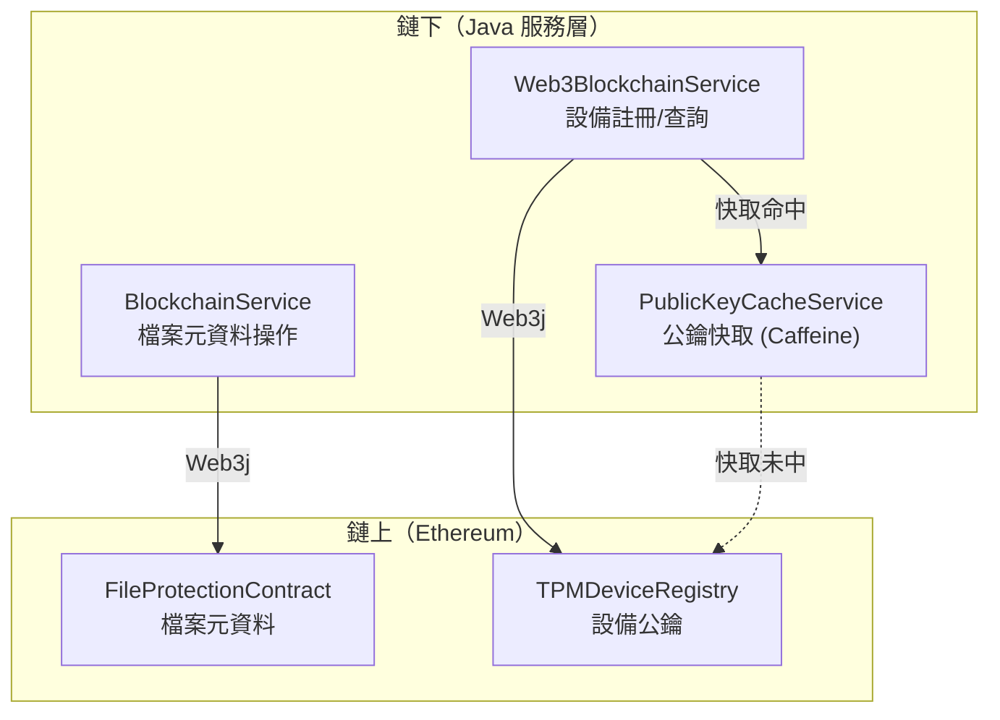
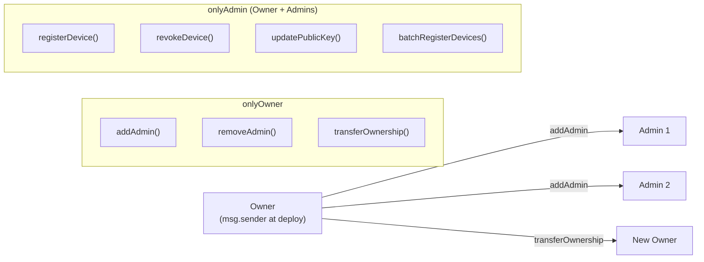
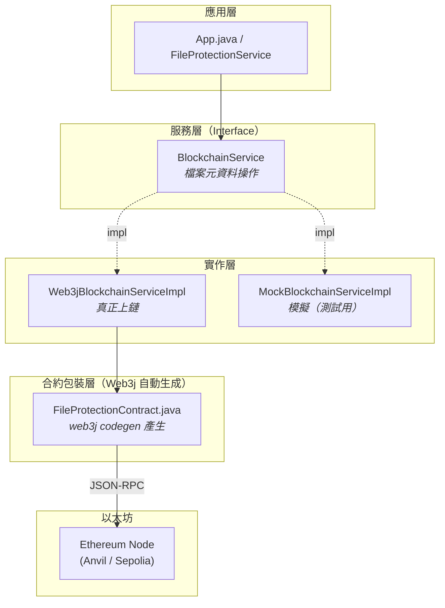
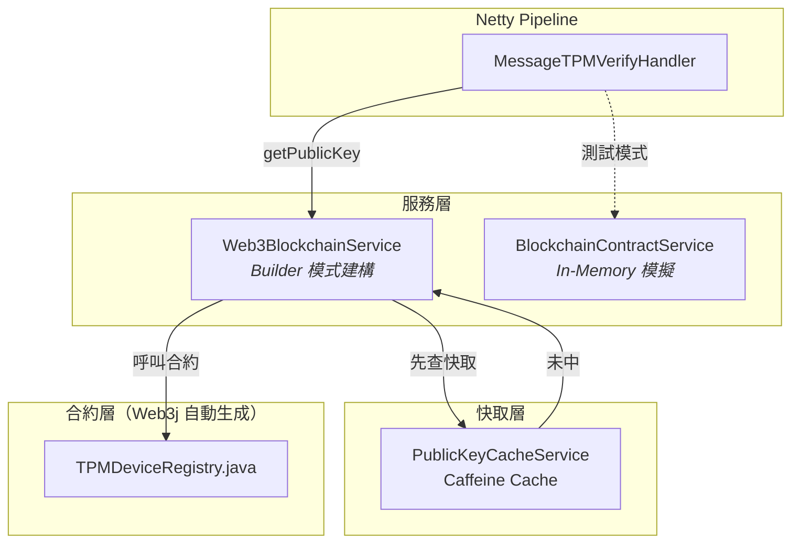
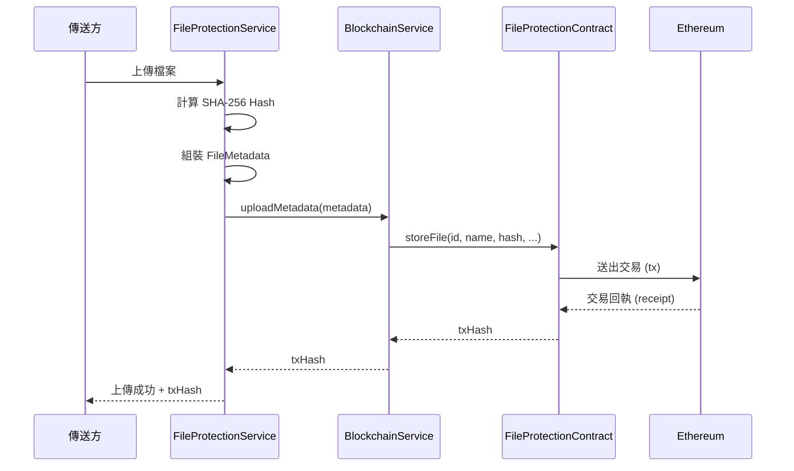
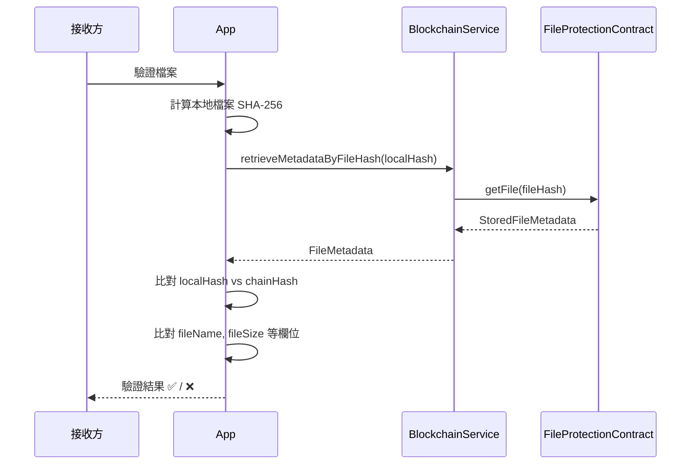
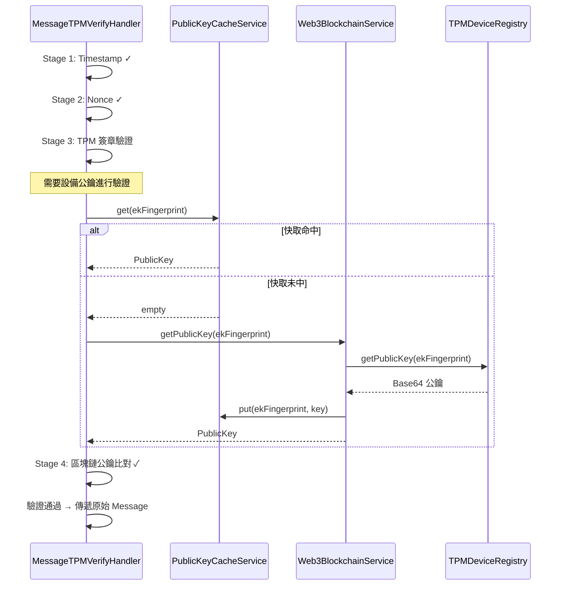

# HiBA 區塊鏈與智慧合約架構說明

> 本文件說明 HiBA 專案中區塊鏈的整合方式、智慧合約設計，以及 Java 服務層的分層架構。

---

## 1. 區塊鏈在 HiBA 中的角色

HiBA 使用以太坊區塊鏈作為 **不可竄改的信任錨點（Trust Anchor）**，具體承擔兩個職責：

| 功能 | 合約 | 用途 |
|------|------|------|
| **檔案完整性驗證** | `FileProtectionContract` | 將檔案的 Hash 與 Metadata 上鏈，供接收方比對 |
| **TPM 設備身份管理** | `TPMDeviceRegistry` | 將 TPM EK 指紋與公鑰的對應關係上鏈，建立設備 PKI |



---

## 2. 智慧合約設計

### 2.1 FileProtectionContract（檔案元資料合約）

- **路徑**：`hiba-core/contract/FileMetadataContract.sol`
- **Solidity 版本**：`^0.8.0`
- **授權**：合約擁有者（`owner`）擁有刪除/清理權限

#### 資料結構

```solidity
struct StoredFileMetadata {
    string id;          // 唯一識別碼
    string fileName;    // 檔案名稱
    string fileHash;    // SHA-256 雜湊值（用作 mapping key）
    string uploader;    // 上傳者名稱
    uint256 fileSize;   // 檔案大小（bytes）
    string filePath;    // 檔案路徑
    string description; // 描述
    uint256 timestamp;  // 上鏈時間戳
    bool exists;        // 是否存在（軟刪除機制）
}

mapping(string => StoredFileMetadata) private files;  // fileHash => Metadata
string[] private fileHashes;                          // 用於遍歷
```

#### 主要功能

| 函數 | 類型 | 說明 |
|------|------|------|
| `storeFile(...)` | write | 儲存單筆檔案元資料 |
| `storeFileWithStruct(FileMetadata)` | write | 使用 struct 儲存（較簡潔） |
| `batchStoreFile(...)` | write | 批次儲存（陣列格式） |
| `batchStoreFileWithStruct(FileMetadata[])` | write | 批次儲存（struct 陣列） |
| `getFile(fileHash)` | view | 以 fileHash 查詢元資料 |
| `getFileAsStruct(fileHash)` | view | 回傳完整 struct |
| `fileExists(fileHash)` | view | 檢查是否存在 |
| `deleteFile(fileHash)` | write | 刪除（僅 owner） |
| `batchDeleteFile(fileHash[])` | write | 批次刪除（僅 owner） |
| `clearAllFiles()` | write | 清空所有（僅 owner） |

#### 事件

```solidity
event FileStored(string fileHash, address indexed uploader, string fileName, uint256 timestamp);
event FileUpdated(string indexed fileHash, address indexed uploader, uint256 timestamp);
event FileDeleted(string indexed fileHash, address indexed deletedBy, uint256 timestamp);
event FilesCleared(address indexed clearedBy, uint256 totalFiles, uint256 timestamp);
event BatchFileStored(address indexed uploader, uint256 filesCount, uint256 timestamp);
event BatchFileDeleted(address indexed deletedBy, uint256 deletedCount, uint256 timestamp);
```

#### 設計特點

- **Upsert 策略**：`storeFile()` 自動判斷是新增（`FileStored`）還是更新（`FileUpdated`）
- **軟刪除**：`deleteFile()` 設定 `exists = false`，並從 `fileHashes` 陣列移除
- **批次操作**：降低多檔案場景的 Gas 成本

---

### 2.2 TPMDeviceRegistry（TPM 設備註冊合約）

- **路徑**：`hiba-core/contract/TPMDeviceRegistry.sol`
- **Solidity 版本**：`^0.8.19`
- **授權**：支援 Owner + Admin 多角色 RBAC

#### 資料結構

```solidity
struct DeviceInfo {
    string publicKey;      // 設備公鑰（Base64 編碼）
    uint256 registeredAt;  // 註冊時間
    bool isActive;         // 是否啟用
    string metadata;       // 額外元資料（JSON）
}

mapping(string => DeviceInfo) private devices;       // ekFingerprint => DeviceInfo
mapping(string => bool) private fingerprintExists;   // 快速存在性查詢
mapping(address => bool) public admins;              // 管理員列表
string[] private registeredFingerprints;             // 用於遍歷
```

#### 主要功能

| 函數 | 權限 | 說明 |
|------|------|------|
| `registerDevice(ekFingerprint, publicKey)` | Admin | 註冊設備 |
| `registerDeviceWithMetadata(...)` | Admin | 註冊並附加元資料 |
| `batchRegisterDevices(ekFP[], pubKey[])` | Admin | 批次註冊（上限 100） |
| `getPublicKey(ekFingerprint)` | Public | 查詢公鑰（已撤銷回傳空） |
| `getDeviceInfo(ekFingerprint)` | Public | 查詢完整資訊 |
| `isDeviceRegistered(ekFingerprint)` | Public | 是否已註冊 |
| `isDeviceActive(ekFingerprint)` | Public | 是否啟用中 |
| `revokeDevice(ekFingerprint)` | Admin | 撤銷（軟刪除） |
| `reactivateDevice(ekFingerprint)` | Admin | 重新啟用 |
| `updatePublicKey(ekFingerprint, newKey)` | Admin | 更新公鑰 |
| `getRegisteredDevices(offset, limit)` | Public | 分頁查詢設備列表 |

#### 權限模型



---

## 3. Java 服務層架構

### 3.1 分層設計



### 3.2 檔案完整性區塊鏈路徑

#### BlockchainService 介面

```
套件：org.gslab.fileProtection.service
```

提供完整的 CRUD 和非同步操作：

| 方法 | 回傳 | 說明 |
|------|------|------|
| `uploadMetadata(FileMetadata)` | `String` (txHash) | 上傳元資料 |
| `batchUploadMetadata(List)` | `String` | 批次上傳 |
| `uploadMetadataWithReceipt(...)` | `TransactionResult` | 上傳並回傳 Gas 資訊 |
| `uploadMetadataAsync(...)` | `CompletableFuture<String>` | 非同步上傳 |
| `retrieveMetadataByFileHash(String)` | `FileMetadata` | 以 fileHash 查詢 |
| `verifyIntegrity(txHash, expectedHash)` | `boolean` | 驗證完整性 |
| `exists(fileHash)` | `boolean` | 是否已上鏈 |
| `isConnected()` | `boolean` | 連線狀態 |

#### 兩種實作

| 實作 | 用途 | 底層 |
|------|------|------|
| `Web3jBlockchainServiceImpl` | **生產環境** | Web3j → `FileProtectionContract.java` → Ethereum |
| `MockBlockchainServiceImpl` | **測試環境** | In-Memory HashMap |

#### FileMetadata 資料模型

```java
public class FileMetadata implements Serializable {
    String id;
    String fileName;
    String fileHash;          // SHA-256 雜湊值
    LocalDateTime uploadTime;
    String uploader;
    long fileSize;
    String filePath;
    String description;
}
```

#### TransactionResult（不可變值物件）

```java
public record TransactionResult(
    String transactionHash,
    BigInteger gasUsed,
    BigInteger gasPrice,
    BigInteger blockNumber,
    String status     // "0x1" = success, "0x0" = failure
) {
    boolean isSuccess();
    double getTotalCostEth();
    double getGasPriceGwei();
}
```

---

### 3.3 TPM 設備註冊區塊鏈路徑



#### Web3BlockchainService（Builder 模式）

```java
Web3BlockchainService service = new Web3BlockchainService.Builder()
    .rpcUrl("http://localhost:8545")      // JSON-RPC 端點
    .contractAddress("0x...")              // 合約地址
    .privateKey("0x...")                   // 交易簽署私鑰
    .cacheService(new PublicKeyCacheService())  // 公鑰快取
    .pollingInterval(1500)                // 輪詢間隔 (ms)
    .pollingAttempts(40)                  // 最大輪詢次數
    .build();
```

主要方法：

| 方法 | 說明 |
|------|------|
| `registerDevice(ekFingerprint, publicKey)` | 寫入合約 |
| `registerDeviceIfNotExists(...)` | 先檢查再註冊（避免重複交易失敗） |
| `registerDeviceAsync(...)` | 非同步註冊 |
| `getPublicKey(ekFingerprint)` | 查詢公鑰（含快取） |
| `isDeviceRegistered(...)` | 是否已註冊 |
| `startEventListeners()` | 監聽鏈上事件 |

#### PublicKeyCacheService（Caffeine 快取）

| 參數 | 預設值 | 說明 |
|------|--------|------|
| 最大容量 | 1000 筆 | 設備公鑰 |
| 寫入過期 | 60 分鐘 | 寫入後自動失效 |
| 存取刷新 | 30 分鐘 | 每次存取延長生命週期 |
| 統計 | 啟用 | 命中率、載入次數等 |

**快取流程**：
1. `MessageTPMVerifyHandler` 需要驗證設備公鑰
2. 先查 `PublicKeyCacheService`（命中則 O(1)）
3. 未中 → 呼叫 `Web3BlockchainService.getPublicKey()` → 鏈上查詢
4. 查到後放入快取供後續使用

#### BlockchainContractService（模擬服務）

用於 **單元測試和開發環境**，不連接真正的區塊鏈：
- 使用 `ConcurrentHashMap` 模擬鏈上狀態
- 加入 50-150ms 隨機延遲模擬網路延遲
- Singleton 模式

---

## 4. 組態管理

### 4.1 配置來源（優先順序由高到低）

| 優先 | 來源 | 適用場景 |
|------|------|----------|
| 1 | **環境變數** | 生產環境（最安全） |
| 2 | **外部 `blockchain.properties`** | 開發環境 |
| 3 | **Classpath `blockchain.properties`** | 測試 |
| 4 | **`env.json` 中的 `tpmDeviceRegistry` 區段** | 全系統配置 |
| 5 | **程式碼預設值** | Fallback |

### 4.2 配置參數

#### blockchain.properties（TPM 設備註冊）

```properties
blockchain.rpc.url=http://localhost:8545
tpm.device.registry.contract.address=0x5FbDB2315678afecb36...
tpm.device.registry.private.key=0xac0974bec39a17e36ba...
blockchain.chain.id=1337
blockchain.gas.price=20000000000
blockchain.gas.limit=500000
```

#### env.json（全系統）

```json
{
  "tpmDeviceRegistry": {
    "rpcUrl": "http://localhost:8545",
    "contractAddress": "0x...",
    "privateKey": "0x..."
  }
}
```

#### 環境變數

| 環境變數 | 對應 |
|----------|------|
| `BLOCKCHAIN_RPC_URL` | RPC 端點 |
| `TPM_REGISTRY_CONTRACT_ADDRESS` | 合約地址 |
| `TPM_REGISTRY_PRIVATE_KEY` | 簽署私鑰 |
| `BLOCKCHAIN_CHAIN_ID` | 鏈 ID |

> [!WARNING]
> **絕勿** 將 `privateKey` 提交到版本控制。生產環境應使用環境變數或密鑰管理服務。

---

## 5. 部署指南

### 5.1 本地開發（Anvil）

```bash
# 啟動 Anvil 本地鏈
anvil --host 0.0.0.0 --port 8545

# 部署合約（使用 Foundry）
forge create --rpc-url http://localhost:8545 \
    --private-key 0xac0974bec39a17e36ba... \
    contract/FileMetadataContract.sol:FileProtectionContract

forge create --rpc-url http://localhost:8545 \
    --private-key 0xac0974bec39a17e36ba... \
    contract/TPMDeviceRegistry.sol:TPMDeviceRegistry
```

### 5.2 測試網（Sepolia）

```bash
forge create --rpc-url https://sepolia.infura.io/v3/<API_KEY> \
    --private-key <YOUR_PRIVATE_KEY> \
    --optimizer-runs 200 \
    contract/FileMetadataContract.sol:FileProtectionContract
```

> [!IMPORTANT]
> 合約體積較大，部署時需開啟 optimizer（`--optimizer-runs 200`）以避免 `max initcode size exceeded` 錯誤。

### 5.3 Web3j Java 包裝類產生

```bash
# 從 Solidity 產生 ABI + BIN
solc --abi --bin contract/FileMetadataContract.sol -o build/

# 產生 Java 包裝類
web3j generate solidity \
    -a build/FileProtectionContract.abi \
    -b build/FileProtectionContract.bin \
    -o src/main/java \
    -p org.gslab.fileProtection.contract
```

產生的 `FileProtectionContract.java` 已位於：
`hiba-core/src/main/java/org/gslab/fileProtection/contract/FileProtectionContract.java`

---

## 6. 端到端流程

### 6.1 檔案上傳流程



### 6.2 檔案驗證流程



### 6.3 TPM 訊息驗證流程（與區塊鏈整合）



---

## 7. 關鍵類別速查

| 類別 | 套件 | 類型 | 職責 |
|------|------|------|------|
| `FileProtectionContract.sol` | `contract/` | Solidity | 檔案元資料上鏈 |
| `TPMDeviceRegistry.sol` | `contract/` | Solidity | 設備 PKI 管理 |
| `BlockchainService` | `fileProtection.service` | Interface | 檔案區塊鏈操作介面 |
| `Web3jBlockchainServiceImpl` | `fileProtection.service.impl` | Class | 真實鏈實作 |
| `MockBlockchainServiceImpl` | `fileProtection.service.impl` | Class | 模擬實作（測試） |
| `FileProtectionContract.java` | `fileProtection.contract` | Class | Web3j 自動產生的合約包裝 |
| `FileMetadata` | `fileProtection.model` | Model | 檔案元資料 DTO |
| `TransactionResult` | `fileProtection.model` | Record | 交易結果值物件 |
| `Web3BlockchainService` | `tpm.blockchain` | Class | TPM 設備註冊服務 |
| `BlockchainContractService` | `tpm.blockchain` | Class | 設備註冊模擬（Singleton） |
| `PublicKeyCacheService` | `tpm` | Class | 公鑰快取（Caffeine） |
| `TPMDeviceRegistryConfig` | `configuration` | Class | 分層配置載入 |

---

## 8. 設計模式總結

| 模式 | 在 HiBA 中的體現 |
|------|-------------------|
| **Strategy** | `BlockchainService` 介面 — 真實/模擬可切換 |
| **Builder** | `Web3BlockchainService.Builder` — 多參數服務建構 |
| **Singleton** | `BlockchainContractService.getInstance()` |
| **Cache-Aside** | `PublicKeyCacheService` — 先查快取再查鏈 |
| **Value Object** | `TransactionResult` (Java record) — 不可變 |
| **Layered Config** | `TPMDeviceRegistryConfig.load()` — 環境變數 > 檔案 > 預設 |
| **Adapter** | `FileProtectionContract.java` — Web3j 產生的合約適配器 |
