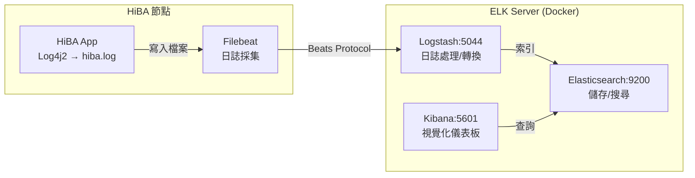
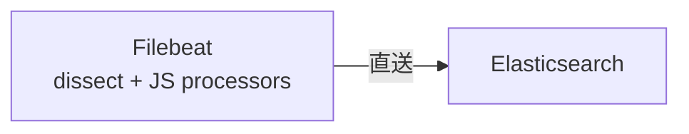

# HiBA ELK Stack 日誌分析環境說明

> 本文件說明 `temp/elk` 目錄中的 ELK（Elasticsearch + Logstash + Kibana）日誌分析環境，包括架構設計、部署方式，以及 HiBA 日誌的採集與處理流程。

---

## 1. 總覽

HiBA 使用 ELK Stack 進行 **集中式日誌管理與視覺化分析**，架構如下：



| 元件 | 版本 | 角色 |
|------|------|------|
| **Elasticsearch** | 8.14.0 | 日誌儲存與全文搜尋引擎 |
| **Logstash** | 8.14.0 | 日誌解析與欄位轉換 |
| **Kibana** | 8.14.0 | 視覺化儀表板 |
| **Filebeat** | 8.14.0 | 日誌檔案採集代理 |

---

## 2. 目錄結構

```
temp/elk/
├── docker-compose.yml              # ELK Stack 容器編排
├── logstash-hiba.conf              # Logstash 管道配置
├── setup-hiba-stream.sh            # Data Stream + ILM 初始化
├── install_filebeat.sh             # Filebeat 安裝與配置（方案一：直送 ES）
├── filebeat-update-config.sh       # Filebeat 更新配置（方案二：送 Logstash）
└── filebeat-8.14.0-amd64.deb       # Filebeat 離線安裝包（~50MB）
```

---

## 3. 部署方式

### 3.1 啟動 ELK Server（Docker）

```bash
cd temp/elk
docker-compose up -d
```

服務端口：

| 服務 | 端口 | 用途 |
|------|------|------|
| Elasticsearch | `9200` | REST API |
| Elasticsearch | `9300` | 節點間通訊 |
| Kibana | `5601` | Web UI |
| Logstash | `5044` | 接收 Filebeat（Beats input） |
| Logstash | `9600` | Logstash Monitoring API |

> [!NOTE]
> `xpack.security.enabled=false`，適用於內網開發環境。生產環境應啟用安全功能。

### 3.2 初始化 Data Stream 與 ILM

```bash
bash setup-hiba-stream.sh
```

此腳本會建立：

| 資源 | 名稱 | 說明 |
|------|------|------|
| **ILM Policy** | `hiba-logs-policy` | Hot（30 天 / 50GB rollover）→ Warm（30 天後 shrink + forcemerge）→ Delete（90 天後刪除） |
| **Index Template** | `hiba-logs-template` | 映射 `hiba-logs*` 的 Data Stream，設定 `@timestamp`、`log.level`、`service.name` 等欄位型態 |

### 3.3 安裝 Filebeat（HiBA 節點上）

```bash
sudo bash install_filebeat.sh
```

此腳本會：
1. 安裝 `filebeat-8.14.0-amd64.deb`
2. 備份既有配置
3. 寫入 HiBA 專用 `filebeat.yml`
4. 驗證配置並啟用 systemd 服務

---

## 4. 兩種日誌採集方案

### 方案一：Filebeat → Elasticsearch（直送）

由 `install_filebeat.sh` 配置。Filebeat 直接將日誌送到 Elasticsearch，解析在 Filebeat 端完成。



**Filebeat 端處理流程（6 階段）**：

| 階段 | 處理器 | 說明 |
|------|--------|------|
| 1 | `dissect` | 將日誌行拆分為 `log_date`、`log_time`、`log_level`、`thread_name`、`java_class_with_line`、`log_message` |
| 2 | `script` (JS) | 合併日期時間為 `@timestamp`，加入 `node_hostname` |
| 3 | `script` (JS) | 正規化 `log_level` 為大寫 |
| 4 | `script` (JS) | 解析 `java_class_with_line`（如 `org.gslab.App:123`）為 `java_package`、`java_class_name`、`line_number` |
| 5 | `script` (JS) | 識別 Netty 事件（`channel_active`/`channel_inactive` 等），提取 `channel_id`、`local_ip`、`remote_ip` |
| 6 | `drop_fields` | 清理臨時欄位 |

### 方案二：Filebeat → Logstash → Elasticsearch（經 Logstash）

由 `filebeat-update-config.sh` 配置。Filebeat 使用 `filestream` 輸入 + NDJSON 解析，將原始 JSON 日誌送到 Logstash 處理。


**Logstash 端處理流程（6 階段）**：

| 階段 | 插件 | 說明 |
|------|------|------|
| 1 | `ruby` | 將 `instant.epochSecond` + `instant.nanoOfSecond` 轉為 `@timestamp` |
| 2 | `mutate.rename` | 欄位重新命名（`level` → `log.level`，`loggerName` → `log.logger`，`thread` → `thread.name` 等） |
| 3 | `ruby` | 展開 `contextMap` → `context.*`（camelCase 轉 snake_case） |
| 4 | `mutate.lowercase` | `log.level` 轉小寫 |
| 5 | `mutate.remove_field` | 移除 `instant`、`endOfBatch`、`loggerFqcn` 等多餘欄位 |
| 6 | `mutate.add_field` | 加入 `ecs.version: 8.0.0` |

> [!TIP]
> 方案二（經 Logstash）更適合日誌格式為 **Log4j2 JSON Layout** 的情境。方案一適合純文字日誌。

---

## 5. HiBA 日誌格式

HiBA 使用 Log4j2 輸出日誌，支援兩種格式：

### 純文字格式（方案一 dissect）

```
2026-01-15 14:30:25.123 INFO  [nioEventLoopGroup-3-1] org.gslab.App:456 - Channel active: [id: 0x1a2b3c4d]
```

### JSON 格式（方案二 NDJSON）

```json
{
  "instant": {"epochSecond": 1705312225, "nanoOfSecond": 123000000},
  "level": "INFO",
  "loggerName": "org.gslab.App",
  "message": "Channel active",
  "thread": "nioEventLoopGroup-3-1",
  "threadId": 15,
  "contextMap": {"nodeId": "node-001"},
  "source": {"class": "org.gslab.App", "method": "channelActive", "file": "App.java", "line": 456}
}
```

---

## 6. 常見操作

### 啟動/停止 ELK

```bash
cd temp/elk

# 啟動
docker-compose up -d

# 查看狀態
docker-compose ps

# 查看 Logstash 日誌
docker-compose logs -f logstash

# 停止
docker-compose down
```

### 管理 Filebeat（HiBA 節點上）

```bash
# 查看狀態
sudo systemctl status filebeat

# 重啟
sudo systemctl restart filebeat

# 查看即時日誌
sudo journalctl -u filebeat -f

# 重設 registry（重新送出所有日誌）
sudo systemctl stop filebeat
sudo rm -rf /var/lib/filebeat/registry/filebeat/*
sudo systemctl start filebeat
```

### 清理 Elasticsearch 資料

```bash
# 刪除指定 Data Stream 的所有資料（在 Kibana Dev Tools 執行）
POST hiba-logs/_delete_by_query?conflicts=proceed
{
  "query": { "match_all": {} }
}
```

---

## 7. 配置參數速查

| 參數 | 預設值 | 說明 |
|------|--------|------|
| `ELASTICSEARCH_HOST` | `192.168.1.60:9200` | ES 位址 |
| `LOG_PATH` | `/home/user/HiBA/logs/hiba.log` | HiBA 日誌路徑 |
| ES JVM Heap | `-Xms1g -Xmx1g` | Elasticsearch 記憶體 |
| LS JVM Heap | `-Xms512m -Xmx512m` | Logstash 記憶體 |
| ILM Hot 階段 | 30 天 / 50GB | 自動 rollover |
| ILM Delete 階段 | 90 天 | 自動刪除 |
