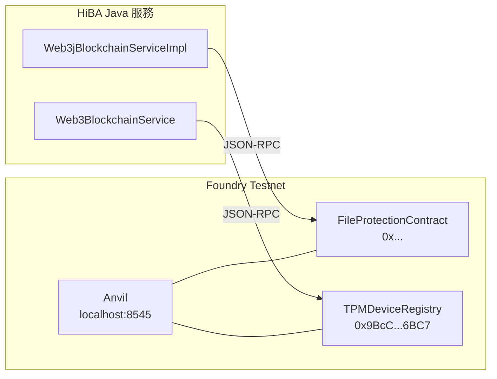

# Foundry Testnet 本地區塊鏈環境說明

> 本文件說明 `temp/foundry-testnet` 專案的用途、結構，以及如何使用 Foundry 工具鏈在本地啟動 Anvil 測試鏈、部署智慧合約，並透過 CLI 工具與合約互動。

---

## 1. 總覽

`temp/foundry-testnet` 是一個 **Foundry 專案**，提供本地以太坊開發環境，用於：

- 編譯和部署 HiBA 的兩份智慧合約
- 使用 Anvil 作為本地測試鏈（Chain ID: `31337`）
- 透過 Shell 腳本與已部署的合約互動
- 匯出/還原 Anvil 鏈上狀態（State Snapshot）

### Foundry 工具鏈

| 工具 | 用途 |
|------|------|
| **Forge** | 編譯、測試、部署合約 |
| **Cast** | 與合約互動（call / send） |
| **Anvil** | 本地以太坊節點 |
| **Chisel** | Solidity REPL |

---

## 2. 目錄結構

```
temp/foundry-testnet/
├── src/                                # Solidity 合約原始碼
│   ├── FileProtectionContract.sol      #   檔案元資料合約
│   ├── TPMDeviceRegistry.sol           #   TPM 設備註冊合約
│   └── Counter.sol                     #   Foundry 範例合約
├── script/
│   ├── Deploy.s.sol                    # 部署腳本
│   └── Counter.s.sol                   # 範例部署腳本
├── test/
│   └── Counter.t.sol                   # 範例測試
├── command/
│   ├── TPM_Device_Registry.sh          # TPM 設備管理 CLI（21 種操作）
│   └── register-device.sh             # 快速設備註冊腳本
├── broadcast/
│   └── Deploy.s.sol/31337/             # 部署交易紀錄
│       ├── run-latest.json             #   最近一次部署
│       └── run-*.json                  #   歷史部署紀錄
├── anvil-file-protection-contract-state.json  # Anvil 狀態快照（~9.5MB）
├── foundry.toml                        # Foundry 配置
├── lib/                                # 依賴庫（forge-std 等）
├── out/                                # 編譯輸出（ABI、Bytecode）
└── cache/                              # Forge 快取
```

---

## 3. 合約說明

### 3.1 FileProtectionContract.sol

用於將檔案元資料（Hash、名稱、大小等）上鏈，供接收方驗證檔案完整性。

| 特性 | 說明 |
|------|------|
| Solidity 版本 | `^0.8.0` |
| 權限 | Owner 可刪除/清空 |
| 寫入方式 | 單筆 `storeFile()` / 批次 `batchStoreFile()` |
| 更新策略 | Upsert（同 fileHash 自動更新） |
| 查詢 | `getFile(fileHash)` / `getFileAsStruct(fileHash)` / `fileExists(fileHash)` |

### 3.2 TPMDeviceRegistry.sol

管理 TPM 設備的 EK 指紋與公鑰對應關係，建立設備 PKI。

| 特性 | 說明 |
|------|------|
| Solidity 版本 | `^0.8.19` |
| 權限 | Owner + Admin 雙層 RBAC |
| 設備生命週期 | 註冊 → 啟用 → 撤銷 → 重新啟用 |
| 批次操作 | 上限 100 筆/次 |
| 查詢 | `getPublicKey()` / `getDeviceInfo()` / `isDeviceActive()` |

> [!NOTE]
> 這兩份合約與 `hiba-core/contract/` 下的合約內容相同，放在此 Foundry 專案中是為了使用 Forge 進行編譯和部署。

---

## 4. 快速開始

### 4.1 前置需求

```bash
# 安裝 Foundry
curl -L https://foundry.paradigm.xyz | bash
foundryup
```

### 4.2 編譯合約

```bash
cd temp/foundry-testnet
forge build
```

### 4.3 啟動 Anvil 本地鏈

```bash
# 基本啟動
anvil --host 0.0.0.0 --port 8545

# 從快照還原啟動（含已部署的合約和狀態）
anvil --host 0.0.0.0 --port 8545 \
    --load-state anvil-file-protection-contract-state.json
```

Anvil 啟動後會提供 10 個預設帳戶，第一個帳戶為：

| 屬性 | 值 |
|------|-----|
| Address | `0xf39Fd6e51aad88F6F4ce6aB8827279cffFb92266` |
| Private Key | `0xac0974bec39a17e36ba4a6b4d238ff944bacb478cbed5efcae784d7bf4f2ff80` |
| Balance | 10000 ETH |

### 4.4 部署合約

```bash
forge script script/Deploy.s.sol:DeployScript \
    --rpc-url http://localhost:8545 \
    --private-key 0xac0974bec39a17e36ba4a6b4d238ff944bacb478cbed5efcae784d7bf4f2ff80 \
    --broadcast
```

> [!IMPORTANT]
> `Deploy.s.sol` 目前只部署 `TPMDeviceRegistry`。若需同時部署 `FileProtectionContract`，請取消 `Deploy.s.sol` 中被註釋的行。

### 4.5 匯出 Anvil 狀態

```bash
# 將當前鏈上狀態匯出為快照
anvil --host 0.0.0.0 --port 8545 \
    --dump-state anvil-file-protection-contract-state.json
```

---

## 5. 已部署合約資訊

根據最近一次部署紀錄（`broadcast/Deploy.s.sol/31337/run-latest.json`）：

| 合約 | 合約地址 |
|------|----------|
| **TPMDeviceRegistry** | `0x9BcC604D4381C5b0Ad12Ff3Bf32bEdE063416BC7` |

---

## 6. CLI 互動工具

### 6.1 TPM_Device_Registry.sh（完整管理工具）

位於 `command/TPM_Device_Registry.sh`，是一個互動式選單工具，提供 21 種操作：

```bash
cd temp/foundry-testnet
bash command/TPM_Device_Registry.sh
```

#### 支援的操作

| 分類 | 操作 | 選單編號 |
|------|------|----------|
| **查詢** | 查詢公鑰 | 1 |
| | 查詢完整設備資訊 | 2 |
| | 檢查是否已註冊 | 3 |
| | 檢查是否啟用 | 4 |
| | 取得設備總數 | 5 |
| | 取得啟用中設備數 | 6 |
| | 分頁查詢設備列表 | 7 |
| **設備管理** | 註冊新設備 | 8 |
| | 註冊含元資料 | 9 |
| | 撤銷設備 | 10 |
| | 重新啟用設備 | 11 |
| | 更新公鑰 | 12 |
| | 更新元資料 | 13 |
| **批次操作** | 批次註冊 | 14 |
| | 批次撤銷 | 15 |
| **管理員** | 新增管理員 | 16 |
| | 移除管理員 | 17 |
| | 轉移擁有權 | 18 |
| **其他** | 查看合約擁有者 | 19 |
| | 檢查是否為管理員 | 20 |
| | 從 TPM 硬體自動註冊 | 21 |

#### 配置方式

腳本支援透過環境變數覆寫預設配置：

```bash
export CONTRACT_ADDRESS="0x9BcC604D4381C5b0Ad12Ff3Bf32bEdE063416BC7"
export RPC_URL="http://127.0.0.1:8545"
export PRIVATE_KEY="0xac0974bec39a17e36ba..."

bash command/TPM_Device_Registry.sh
```

### 6.2 register-device.sh（快速註冊）

用於單行指令快速註冊設備：

```bash
bash command/register-device.sh "<EK_FINGERPRINT>" "<PUBLIC_KEY_BASE64>"
```

---

## 7. 直接使用 Cast 指令

除了 CLI 工具外，也可直接使用 `cast` 與合約互動：

### 查詢（call — 不消耗 Gas）

```bash
# 查詢公鑰
cast call 0x9BcC604D4381C5b0Ad12Ff3Bf32bEdE063416BC7 \
    "getPublicKey(string)(string)" \
    "YOUR_EK_FINGERPRINT" \
    --rpc-url http://127.0.0.1:8545

# 檢查設備是否已註冊
cast call 0x9BcC604D4381C5b0Ad12Ff3Bf32bEdE063416BC7 \
    "isDeviceRegistered(string)(bool)" \
    "YOUR_EK_FINGERPRINT" \
    --rpc-url http://127.0.0.1:8545

# 取得設備總數
cast call 0x9BcC604D4381C5b0Ad12Ff3Bf32bEdE063416BC7 \
    "getDeviceCount()(uint256)" \
    --rpc-url http://127.0.0.1:8545
```

### 寫入（send — 消耗 Gas，需私鑰）

```bash
# 註冊設備
cast send 0x9BcC604D4381C5b0Ad12Ff3Bf32bEdE063416BC7 \
    "registerDevice(string,string)" \
    "EK_FINGERPRINT_HERE" \
    "BASE64_PUBLIC_KEY_HERE" \
    --rpc-url http://127.0.0.1:8545 \
    --private-key 0xac0974bec39a17e36ba4a6b4d238ff944bacb478cbed5efcae784d7bf4f2ff80

# 撤銷設備
cast send 0x9BcC604D4381C5b0Ad12Ff3Bf32bEdE063416BC7 \
    "revokeDevice(string)" \
    "EK_FINGERPRINT_HERE" \
    --rpc-url http://127.0.0.1:8545 \
    --private-key 0xac0974bec39a17e36ba...
```

---

## 8. 與 HiBA Java 服務的整合

此 Foundry 專案部署的合約，由 HiBA Java 服務層透過 **Web3j** 連接：



Java 服務需在 `blockchain.properties` 中配置對應的合約地址和 RPC URL：

```properties
blockchain.rpc.url=http://localhost:8545
tpm.device.registry.contract.address=0x9BcC604D4381C5b0Ad12Ff3Bf32bEdE063416BC7
tpm.device.registry.private.key=0xac0974bec39a17e36ba...
blockchain.chain.id=1337
```

---

## 9. 常見操作流程

### 全新環境設定

```bash
# 1. 啟動 Anvil
anvil --host 0.0.0.0 --port 8545

# 2. 編譯合約
forge build

# 3. 部署合約
forge script script/Deploy.s.sol:DeployScript \
    --rpc-url http://localhost:8545 \
    --private-key 0xac0974bec39a17e36ba4a6b4d238ff944bacb478cbed5efcae784d7bf4f2ff80 \
    --broadcast

# 4. 記錄合約地址（從部署輸出或 broadcast/ 中取得）

# 5. 使用 CLI 管理設備
bash command/TPM_Device_Registry.sh
```

### 還原已有環境

```bash
# 直接從快照啟動，合約和資料都已存在
anvil --host 0.0.0.0 --port 8545 \
    --load-state anvil-file-protection-contract-state.json
```

> [!TIP]
> 使用 `--load-state` 可避免每次重啟都需重新部署，大幅節省開發時間。快照檔案 `anvil-file-protection-contract-state.json` 包含了完整的鏈上狀態（合約、帳戶餘額、交易歷史等）。

---

## 10. 注意事項

> [!WARNING]
> 此專案使用的私鑰 `0xac0974...` 是 **Anvil 預設測試私鑰**，僅限本地開發使用。**絕對不要**在主網或公共測試網上使用此私鑰。

- **合約體積**：`FileProtectionContract` 和 `TPMDeviceRegistry` 體積較大。若部署到公共測試網或主網，需在 `foundry.toml` 中開啟 optimizer：
  ```toml
  [profile.default]
  optimizer = true
  optimizer_runs = 200
  ```
- **Chain ID**：本地 Anvil 的預設 Chain ID 為 `31337`
- **Gas 費用**：Anvil 本地鏈 Gas 免費，但交易仍需有足夠的 ETH 餘額
- **狀態持久化**：Anvil 預設為 in-memory，重啟後資料會遺失。使用 `--dump-state` / `--load-state` 進行持久化
