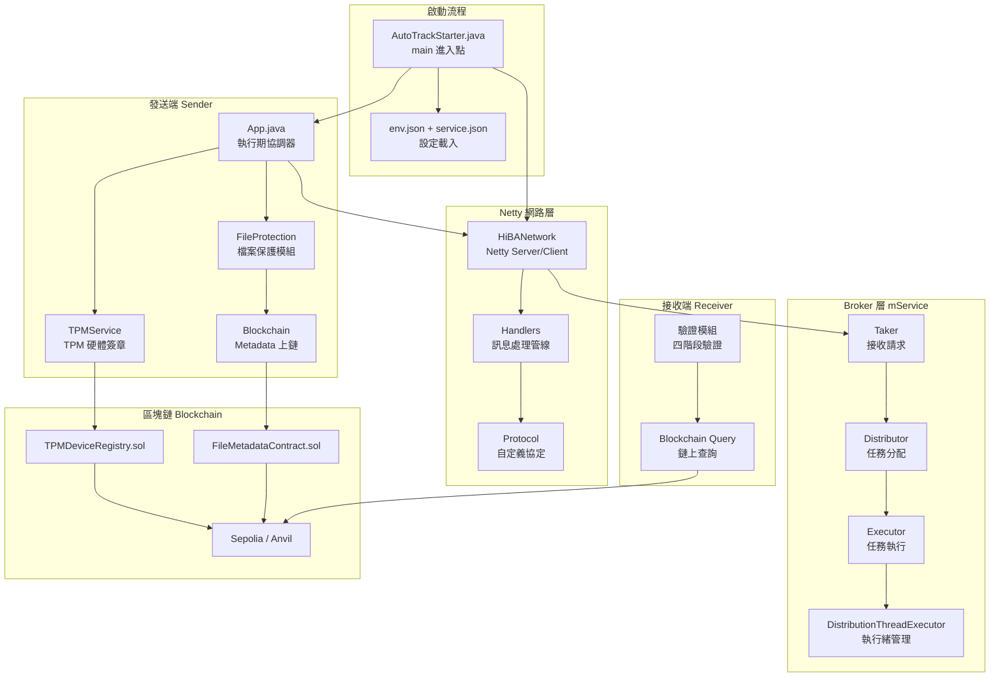

# HiBA 專案交接文件

> **專案名稱：** HiBA（Hierarchical Broker Architecture）
> **技術棧：** Java 21 + Netty + Web3j + Solidity + Ansible + Python
> **最後更新：** 2026-02-22
> **GIT Repository：** <https://github.com/socomni/hiba>

---

## 目錄

1. [專案總覽](#1-專案總覽)
2. [系統架構](#2-系統架構)
3. [模組說明](#3-模組說明)
4. [區塊鏈相關](#4-區塊鏈相關)
5. [設定檔說明](#5-設定檔說明)
6. [開發環境建置](#6-開發環境建置)
7. [測試環境建置](#7-測試環境建置)
8. [部署與運維](#8-部署與運維)
9. [測試說明](#9-測試說明)
10. [已知問題與注意事項](#10-已知問題與注意事項)
11. [常見問題 FAQ](#11-常見問題-faq)

---

## 1. 專案總覽

### 1.1 專案目的

<!-- TODO: 用 2-3 句話說明這個系統要解決什麼問題 -->

HiBA 是一個基於階層式 Broker 架構的分散式檔案傳輸與驗證系統，結合 **TPM 硬體簽章** 和 **區塊鏈（Ethereum）** 技術，確保檔案在傳輸過程中的 **完整性（Integrity）** 與 **不可否認性（Non-repudiation）**。

### 1.2 核心功能

| 功能 | 說明 |
|------|------|
| **分散式任務分配** | 透過 Taker → Distributor → Executor 流水線分派任務 |
| **Netty 網路通訊** | 基於 Netty 的自定義協定實現節點間通訊 |
| **SDN 網路控制** | 支援行動網路切換與 Multicast 群播 |
| **TPM 硬體簽章** | 利用 TPM 晶片進行訊息簽章與多階段驗證  |
| **區塊鏈檔案保護** | 檔案 metadata 上鏈，接收端可驗證檔案完整性 |
| **自動化部署** | 透過 Ansible 管理多節點部署、重啟、停止 |

### 1.3 Maven 模組結構

```
hiba-management (parent pom)
├── hiba-common        # 共用程式碼（工具類、常數等）
├── hiba-core          # 核心模組（所有業務邏輯）
└── hiba-service-ntp   # NTP 時間同步服務
```

---

## 2. 系統架構

### 2.1 整體架構圖

<!-- TODO: 替換為你的論文架構圖，或用下方 Mermaid 圖 -->



### 2.2 核心資料流程

#### 傳送方上傳流程

```
1. 擷取檔案 metadata（檔名、大小、hash 等）
2. 使用 TPM 進行硬體簽章
3. 將簽章後的 metadata 寫入區塊鏈（FileMetadataContract）
4. 透過 Netty 傳輸檔案至接收端
```

#### 接收方驗證流程（四階段）

```
Stage 1: Timestamp 驗證（檢查時間戳是否在容許範圍內）
Stage 2: Nonce 驗證（防止重放攻擊）
Stage 3: TPM 簽章驗證（驗證 TPM 硬體簽章）
Stage 4: 區塊鏈完整性驗證（比對鏈上 metadata 與本地檔案 hash）
```

---

## 3. 模組說明

### 3.1 核心模組 `hiba-core`

#### 3.1.1 主程式入口

| 檔案 | 說明 |
|------|------|
| `AutoTrackStarter.java` | **系統 `main()` 進入點** — 載入 `env.json` 與 `service.json`、初始化 `HiBANetwork`、透過反射動態建立 Taker/Distributor/Executor、組裝 `App`、啟動 HTTP Server |
| `App.java` | **執行期協調器** — 封裝 `SdnNetwork`，管理服務註冊、請求發送 (`sendRequest`)、檔案傳輸與驗證 (`performSingleFileVerification`) |
| `HiBAService.java` | 微服務封裝（包含一組 Taker + Distributor + Executor） |

#### 3.1.2 mService 微服務管線

| 檔案 | 職責 |
|------|------|
| `Taker.java` | **接收端** — 接收來自其他節點的請求 |
| `Distributor.java` | **分配器** — 根據策略將任務分配給合適的 Executor |
| `Executor.java` | **執行器** — 實際執行分配到的任務 |
| `DistributionThreadExecutor.java` | **執行緒管理** — 管理任務執行的執行緒池與排程邏輯 |

<!-- TODO: 補充各元件之間的資料流與通訊方式 -->

#### 3.1.3 SDN 網路層 (`sdns/`)

| 檔案 | 說明 |
|------|------|
| `HiBANetwork.java` | Netty 核心網路實作（86KB），含 Server/Client Bootstrap |
| `HiBAInitial.java` | 網路初始化邏輯（Channel Pipeline 設定） |
| `HiBAFileTransferServer.java` | 檔案傳輸 Server |
| `FileTransferClient.java` | 檔案傳輸 Client |
| `HiBAHttpRequestServer.java` | HTTP 請求 Server |
| `HttpRequestHandler.java` | HTTP 請求處理器 |
| `LocalTestNetwork.java` | 本地測試用網路（不需實體多節點） |
| `DistributionThreadExecutor.java` | 任務分發的執行緒排程 |

#### 3.1.4 Handler 管線 (`handlers/`)

| 檔案 | 說明 |
|------|------|
| `ServerChannelHandlers.java` | Server 端 Channel Handler（49KB，最大的 handler） |
| `ClientChannelHandlers.java` | Client 端 Channel Handler |
| `MessageTPMSignHandler.java` | 訊息 TPM 簽章處理 |
| `MessageTPMVerifyHandler.java` | 訊息 TPM 驗證處理（多階段驗證） |
| `TimestampValidator.java` | Stage 1 — 時間戳驗證 |
| `NonceValidator.java` | Stage 2 — Nonce 防重放驗證 |
| `BrokerCompletionHandlers.java` | Broker 任務完成處理 |
| `BrokerRegistrationHandlers.java` | Broker 註冊處理 |

#### 3.1.5 TPM 模組 (`tpm/`)

| 檔案 | 說明 |
|------|------|
| `TPMService.java` | TPM 服務核心（59KB），包含 TPM 簽章、驗證、公鑰管理 |
| `PublicKeyCacheService.java` | TPM 公鑰快取服務（Caffeine Cache） |
| `blockchain/` | TPM 裝置註冊的區塊鏈互動 |

#### 3.1.6 檔案保護模組 (`fileProtection/`)

| 子目錄 | 說明 |
|--------|------|
| `BlockchainFileProtectManager.java` | 檔案保護管理器（協調各元件） |
| `service/` | 區塊鏈服務介面與實作（Web3j） |
| `contract/` | Solidity 合約的 Java Wrapper |
| `database/` | 本地資料庫（SQLite / PostgreSQL）管理 |
| `cache/` | 區塊鏈查詢快取 |
| `config/` | 檔案保護相關設定 |
| `model/` | 資料模型（FileMetadata 等） |
| `util/` | 工具類（Hash 計算、設定讀取、FileMetadataFactory） |
| `performance/` | 效能測試工具 |
| `adapter/` | 設計模式——適配器 |
| `exception/` | 自定義例外 |

#### 3.1.7 訊息定義 (`message_hiba/`)

包含 42 個訊息類別，主要分為：

| 分類 | 代表訊息 |
|------|----------|
| **註冊/登入** | `RegisteMessage`, `LoginMessage` |
| **任務管理** | `TaskStartMessage`, `TaskFinishMessage`, `WaitingRequestMessage` |
| **檔案傳輸** | `FileTransferMessage`, `FileDownloadMessage`, `FileTranferFinishMessage` |
| **Broker 管理** | `BrokerCheckMessage`, `GetBrokerList`, `ScorePublishMessage` |
| **TPM 簽章** | `SignedMessage`（包裝所有簽章訊息） |
| **連線管理** | `connectionTestMessenge`, `createReverseChannelMessage` |

#### 3.1.8 設定模組 (`configuration/`)

| 檔案 | 說明 |
|------|------|
| `SystemConfigurationLoader.java` | 系統設定載入器（讀取 `env.json`） |
| `HibaNetworkConfig.java` | 網路設定（Port、SSL、Multicast 等） |
| `MessageVerificationConfig.java` | 訊息驗證設定 |
| `TPMDeviceRegistryConfig.java` | TPM 裝置註冊設定（含區塊鏈連線） |
| `MobileNetworkConfig.java` | 行動網路設定 |
| `MulticastConfig.java` | Multicast 群播設定 |
| `ServiceConfiguration.java` | 服務設定 |

#### 3.1.9 SDN 行動控制 (`sdnMobileControl/`)

| 檔案 | 說明 |
|------|------|
| `MobileNetworkController.java` | 行動網路控制器（Wi-Fi 切換、OBU 管理） |
| `multicast/` | Multicast 群播相關實作 |

---

## 4. 區塊鏈相關

### 4.1 智慧合約

| 合約 | 路徑 | 用途 |
|------|------|------|
| `FileMetadataContract.sol` | `hiba-core/contract/` | 儲存檔案 metadata（hash, 檔名, 上傳者, 時間戳） |
| `TPMDeviceRegistry.sol` | `hiba-core/contract/` | 註冊與管理 TPM 裝置公鑰 |

### 4.2 部署環境

| 環境 | 類型 | RPC URL | 用途 |
|------|------|---------|------|
| **Anvil** | 私有測試鏈 | `http://192.168.1.60:8545` | 本地開發/測試（Network ID: 31337） |
| **Sepolia** | 公開測試鏈 | _(填入 Infura/Alchemy URL)_ | 論文展示/正式測試 |

### 4.3 合約部署步驟

<!-- TODO: 補充具體步驟 -->

```bash
# 1. 啟動 Anvil 本地鏈
anvil --host 0.0.0.0 --port 8545

# 2. 部署合約（使用 Remix 或 Foundry）
# 注意：需開啟 optimizer 避免 "max initcode size exceeded" 錯誤
# Remix: Settings → Compiler → Enable optimization (runs: 200)
# Foundry:
forge create --rpc-url http://127.0.0.1:8545 \
  --private-key <PRIVATE_KEY> \
  --optimize --optimizer-runs 200 \
  src/FileMetadataContract.sol:FileMetadataContract
```

### 4.4 已部署合約地址

<!-- TODO: 填入目前使用的合約地址 -->

| 環境 | FileMetadataContract | TPMDeviceRegistry |
|------|---------------------|-------------------|
| Anvil | `0x...` | `0x...` |
| Sepolia | `0x...` | `0x...` |

### 4.5 帳戶與私鑰

> **⚠️ 警告：** 以下私鑰僅用於測試環境，切勿用於主網。

- 設定方式見 `env.json` 的 `BlockchainFileProtect.privateKey` 和 `BlockchainTPMRegistry.privateKey`
- 也可透過環境變數覆蓋：`BLOCKCHAIN_PRIVATE_KEY`, `TPM_DEVICE_REGISTRY_PRIVATE_KEY`

<!-- TODO: 記錄測試用帳戶地址和 Sepolia 水龍頭資訊 -->

---

## 5. 設定檔說明

### 5.1 `env.json`（主設定檔）

路徑：`hiba-core/env.json`

```
env.json
├── HiBANetwork         # 網路設定
│   ├── isAccountingServer  # 是否為 Accounting Server（Broker 角色）
│   ├── nodeName            # 節點名稱
│   ├── HiBA_PORT           # 主通訊 Port (8091)
│   ├── DATA_PORT           # 資料傳輸 Port (8088)
│   ├── REVERSE_DATA_PORT   # 反向通道 Port (8089)
│   ├── HTTP_REQUEST_PORT   # HTTP 請求 Port (8092)
│   ├── tpmSignatureVerification  # 是否啟用 TPM 驗證
│   └── BlockchainFileProtect     # 是否啟用區塊鏈檔案保護
│
├── MobileNetwork       # 行動網路設定（SDN 相關）
│   ├── state               # 是否啟用行動網路
│   ├── wifiInterface       # Wi-Fi 介面名稱
│   └── OBU                 # 車載單元設定
│
├── multicastController # Multicast 群播設定
│   ├── initMCASTFrequency      # 群播頻率
│   └── initMCASTTimeInterval   # 群播間隔 (ms)
│
├── Blockchain          # 區塊鏈連線設定（共用）
│   ├── rpcURL              # RPC 端點 URL
│   ├── networkID           # 網路 ID (31337=Anvil, 11155111=Sepolia)
│   ├── gasPrice / gasLimit # Gas 設定
│   └── pollingIntervalMs / pollingAttempts  # 交易輪詢設定
│
├── BlockchainFileProtect  # 檔案保護區塊鏈設定
│   ├── serviceType         # "web3j" or "mock"
│   ├── contractAddress     # 合約地址
│   ├── privateKey          # 私鑰（建議用環境變數）
│   ├── databaseURL         # 本地 SQLite DB
│   └── retry*              # 重試設定
│
└── BlockchainTPMRegistry  # TPM 裝置註冊設定
    ├── contractAddress     # 合約地址
    ├── privateKey          # 私鑰
    └── enablePublicKeyCache / maxCacheSize  # 公鑰快取設定
```

### 5.2 環境變數覆蓋（用於部署環境）

| 環境變數 | 對應設定 | 說明 |
|----------|----------|------|
| `BLOCKCHAIN_PRIVATE_KEY` | `BlockchainFileProtect.privateKey` | 檔案保護私鑰 |
| `BLOCKCHAIN_CONTRACT_ADDRESS` | `BlockchainFileProtect.contractAddress` | 檔案保護合約地址 |
| `BLOCKCHAIN_RPC_URL` | `Blockchain.rpcURL` | RPC 連線 URL |
| `TPM_DEVICE_REGISTRY_PRIVATE_KEY` | `BlockchainTPMRegistry.privateKey` | TPM 註冊私鑰 |
| `TPM_DEVICE_REGISTRY_CONTRACT_ADDRESS` | `BlockchainTPMRegistry.contractAddress` | TPM 註冊合約地址 |

---

## 6. 開發環境建置

### 6.1 前置需求

| 工具 | 版本 | 安裝方式 |
|------|------|----------|
| **OpenJDK** | 21 | `sudo apt install openjdk-21-jdk` |
| **Maven** | 3.9+ | `sudo apt install maven` |
| **VSCode** | Latest | [下載連結](https://code.visualstudio.com/) |
| **Foundry (Anvil)** | Latest | `curl -L https://foundry.paradigm.xyz \| bash && foundryup` |
| **Python** | 3.10+ | `sudo apt install python3 python3-pip` |
| **Ansible** | 2.15+ | `pip3 install ansible` |

### 6.2 推薦 VSCode Extensions

<!-- TODO: 補充你實際使用的 extensions -->

| Extension | 用途 |
|-----------|------|
| Extension Pack for Java | Java 開發 |
| Solidity | 智慧合約語法高亮 |
| Remote - SSH | 連線到 PVE 測試環境 |

### 6.3 首次設定步驟

```bash
# 1. Clone 專案
git clone <repo-url> && cd hiba

# 2. 編譯（跳過測試）
make compile

# 3. 打包（產生 JAR）
make package
# 產出位置：hiba-core/target/hiba-core-0.0.1.jar
# 以及 output/ 目錄（用於 Ansible 部署）

# 4. 設定 env.json
# 編輯 hiba-core/env.json，填入正確的：
#   - 區塊鏈 RPC URL
#   - 合約地址
#   - 私鑰（或設定環境變數）

# 5. 啟動本地區塊鏈（可選）
anvil --host 0.0.0.0 --port 8545

# 6. 部署合約（如果是全新環境）
# 見第 4.3 節
```

---

## 7. 測試環境建置

### 7.1 PVE 虛擬化平台

<!-- TODO: 補充 PVE 登入資訊、VM 配置 -->

| 項目 | 說明 |
|------|------|
| **PVE 管理介面** | `https://<PVE_IP>:8006` |
| **帳號** | _(填入)_ |
| **VM 數量** | 11 台（1 accounting-server + 10 nodes） |

### 7.2 節點清單

| PVE VM ID | PVE 名稱 | 節點名稱 | IP 位址 | 子網 | 角色 |
|-----------|----------|----------|---------|------|------|
| 301 | HiBA-Node1 | `node1` | 192.168.1.245 | 192.168.1.x | Worker Node |
| 302 | HiBA-Node2 | `node2` | 192.168.1.171 | 192.168.1.x | Worker Node |
| 303 | HiBA-AccountingServer | `accounting-server` | 192.168.1.222 | 192.168.1.x | Broker / Accounting Server |
| 304 | HiBA-Node3 | `node3` | 192.168.2.56 | 192.168.2.x | Worker Node |
| 305 | HiBA-Node4 | `node4` | 192.168.2.57 | 192.168.2.x | Worker Node |
| 306 | HiBA-Node5 | `node5` | 192.168.2.58 | 192.168.2.x | Worker Node |
| 307 | HiBA-Node6 | `node6` | 192.168.2.59 | 192.168.2.x | Worker Node |
| 308 | HiBA-Node7 | `node7` | 192.168.3.60 | 192.168.3.x | Worker Node |
| 309 | HiBA-Node8 | `node8` | 192.168.3.61 | 192.168.3.x | Worker Node |
| 310 | HiBA-Node9 | `node9` | 192.168.3.62 | 192.168.3.x | Worker Node |
| 311 | HiBA-Node10 | `node10` | 192.168.3.63 | 192.168.3.x | Worker Node |

### 7.3 SSH Port Forwarding（外部連線）

透過路由器 NAT 規則，從外部網路 SSH 連入各台 VM：

| 規則名稱 | 對外 Port | 對內 Port | 內部 IP | 對應節點 |
|----------|-----------|-----------|---------|----------|
| `vm-301-ssh` | **30122** | 22 | 192.168.1.245 | node1 |
| `vm-302-ssh` | **30222** | 22 | 192.168.1.171 | node2 |
| `vm-303-ssh` | **30322** | 22 | 192.168.1.222 | accounting-server |
| `vm-304-ssh` | **30422** | 22 | 192.168.2.56 | node3 |
| `vm-305-ssh` | **30522** | 22 | 192.168.2.57 | node4 |
| `vm-306-ssh` | **30622** | 22 | 192.168.2.58 | node5 |
| `vm-307-ssh` | **30722** | 22 | 192.168.2.59 | node6 |
| `vm-308-ssh` | **30822** | 22 | 192.168.3.60 | node7 |
| `vm-309-ssh` | **30922** | 22 | 192.168.3.61 | node8 |
| `vm-310-ssh` | **31022** | 22 | 192.168.3.62 | node9 |
| `vm-311-ssh` | **31122** | 22 | 192.168.3.63 | node10 |

> [!TIP]
> Port 規則：`30X22`，其中 `X` 對應 VM 編號（301–311）。

#### 外部連線方式

```bash
# 連線到 node1（192.168.1.245）
ssh -p 30122 user@163.18.49.35

# 連線到 accounting-server（192.168.1.222）
ssh -p 30322 user@163.18.49.35
```

#### 建議 SSH Config（`~/.ssh/config`）

```ssh-config
# HiBA 測試環境
Host hiba-node1
    HostName 163.18.49.35
    Port 30122
    User user

Host hiba-node2
    HostName 163.18.49.35
    Port 30222
    User user

Host hiba-accounting
    HostName 163.18.49.35
    Port 30322
    User user

Host hiba-node3
    HostName 163.18.49.35
    Port 30422
    User user

Host hiba-node4
    HostName 163.18.49.35
    Port 30522
    User user

Host hiba-node5
    HostName 163.18.49.35
    Port 30622
    User user

Host hiba-node6
    HostName 163.18.49.35
    Port 30722
    User user

Host hiba-node7
    HostName 163.18.49.35
    Port 30822
    User user

Host hiba-node8
    HostName 163.18.49.35
    Port 30922
    User user

Host hiba-node9
    HostName 163.18.49.35
    Port 31022
    User user
```

設定完成後即可用簡短指令連線：

```bash
ssh hiba-node1
ssh hiba-accounting
```

### 7.4 每台節點的軟體環境

```bash
# 確認 Java 版本
java --version  # 應為 openjdk 21

# 確認 Python
python3 --version

# 確認工作目錄
ls /home/user/HiBA/  # 部署目標目錄
```

---

## 8. 部署與運維

### 8.1 Ansible 架構

```
ansible/
├── hosts.ini                    # Inventory（所有節點清單）
├── group_vars/
│   └── hiba_service.yaml        # 群組變數（路徑、JAR 名稱、Log 等級）
├── playbooks/
│   ├── deploy-run-hiba-service.yaml     # 部署並啟動
│   ├── restart-hiba-service.yaml        # 重啟服務
│   ├── stop-hiba-service.yaml           # 停止服務
│   ├── start-hiba-service.yaml          # 啟動服務
│   ├── rolling-restart-hiba-service.yaml# 滾動重啟
│   ├── rolling-update-tasks.yaml        # 滾動更新任務
│   └── cleanup-database.yaml            # 清除資料庫
├── deploy-run-hiba-service.sh   # 部署 Shell 腳本
├── restart-hiba-service.sh      # 重啟 Shell 腳本
├── stop-hiba-service.sh         # 停止 Shell 腳本
├── rolling-restart-hiba-service.sh # 滾動重啟腳本
├── run-cmd.sh                   # 遠端執行命令腳本
└── cleanup-database.sh          # 清除資料庫腳本
```

### 8.2 常用部署命令

```bash
# === 完整流程：編譯 → 打包 → 部署 ===

# Step 1: 打包
make package

# Step 2: 部署到所有節點
make ansible-deploy

# Step 3: 部署到特定節點
make ansible-deploy HOST=node1
make ansible-deploy HOSTS='node1 node2 node3'

# === 運維操作 ===

# 重啟所有節點
make ansible-restart

# 停止特定節點
make ansible-stop HOST=accounting-server

# 滾動重啟（不影響服務可用性）
make ansible-rolling-restart

# 查看可用節點
make hosts
```

### 8.3 關鍵路徑

| 位置 | 本地路徑 | 遠端路徑 |
|------|----------|----------|
| 編譯輸出 | `output/` | — |
| 部署目標 | — | `/home/user/HiBA/` |
| JAR 檔案 | `output/hiba-core-0.0.1.jar` | `/home/user/HiBA/hiba-core-0.0.1.jar` |
| PID 檔案 | — | `/home/user/HiBA/hiba.pid` |
| 啟動日誌 | — | `/home/user/HiBA/logs/startup.log` |
| SQLite DB | — | `/home/user/HiBA/blockchain_manager.db` |

### 8.4 HTTP API 請求

每個 HiBA 節點在 `HTTP_REQUEST_PORT`（預設 `8092`）上提供 HTTP API，可透過 `curl` 觸發微服務請求。

#### 共用參數

| 參數 | 說明 |
|------|------|
| `serviceName` | 微服務名稱（對應 `service.json` 中的定義） |
| `requestName` | 請求名稱（通常與 serviceName 相同） |

#### 8.4.1 getFile — 檔案下載

從其他節點取得檔案：

```bash
# JSON 格式（單檔）
curl -X POST http://localhost:8092/ \
  -H "Content-Type: application/json" \
  -d '{
    "serviceName": "getFile",
    "requestName": "getFile",
    "fileName": "file_6_1.txt"
  }'

# Form 格式（單檔）
curl -X POST http://localhost:8092/ \
  -F "serviceName=getFile" \
  -F "requestName=getFile" \
  -F "fileName=file_6_1.txt"

# 多檔下載
curl -X POST http://localhost:8092/ \
  -F "serviceName=getFile" \
  -F "requestName=getFile" \
  -F "fileName=file_6_1.txt" \
  -F "fileName=file_1_1.txt" \
  -v
```

#### 8.4.2 BlockchainFileProtect — 檔案上鏈保護

將檔案 metadata 上傳至區塊鏈：

```bash
# 上傳檔案路徑（不保留本地檔案）
curl -X POST http://localhost:8092/ \
  -F "serviceName=BlockchainFileProtect" \
  -F "requestName=BlockchainFileProtect" \
  -F "description=test" \
  -F "keepFile=false" \
  -F "file=/home/user/HiBA/model_111_211_221_311.xml" \
  -v

# 上傳實際檔案內容（保留本地檔案）
curl -X POST http://192.168.3.62:8092/ \
  -F "serviceName=BlockchainFileProtect" \
  -F "requestName=BlockchainFileProtect" \
  -F "description=test" \
  -F "keepFile=true" \
  -F "file=@/home/user/HiBA/files/file_8_2.txt" \
  -v
```

| 參數 | 說明 |
|------|------|
| `description` | 檔案描述 |
| `keepFile` | `true` = 保留本地檔案，`false` = 上傳後刪除 |
| `file` | 檔案路徑（無 `@` 前綴）或實際檔案上傳（`@` 前綴） |

#### 8.4.3 BlockchainFileIntegrity — 檔案完整性驗證

驗證檔案與區塊鏈上的 metadata 是否一致：

```bash
# 以檔名查詢驗證
curl -X POST http://192.168.3.62:8092/ \
  -F "serviceName=BlockchainFileIntegrity" \
  -F "requestName=BlockchainFileIntegrity" \
  -F "fileName=file_9_1.txt" \
  -v | jq .

# 上傳檔案進行驗證
curl -X POST http://localhost:8092/ \
  -F "serviceName=BlockchainFileIntegrity" \
  -F "requestName=BlockchainFileIntegrity" \
  -F "file=@/home/user/HiBA/files/file_9_1.txt" \
  -v | jq .
```

---

## 9. 測試說明

### 9.1 測試分類

#### TPM 相關測試

| 測試類別 | 檔案 | 說明 |
|----------|------|------|
| 多階段驗證 | `TPMMultiStageVerificationTest.java` | 四階段驗證流程完整測試 |
| 攻擊模擬 | `TPMAttackSimulationTest.java` | MITM、重放、身份偽造、資料竄改攻擊 |
| 組合攻擊 | `TPMCombinationAttackTest.java` | 複合攻擊場景 |
| 邊界值 | `TPMBoundaryValueTest.java` | 邊界條件測試 |
| 效能 | `TPMPerformanceTest.java` | 簽章/驗證延遲測試 |
| 方案比較 | `TPMSchemeComparisonTest.java` | 不同簽章方案比較 |

#### 檔案保護相關測試

| 測試類別 | 檔案 | 說明 |
|----------|------|------|
| 完整性驗證 | `FileMetadataIntegrityTest.java` | 檔案 metadata 上鏈/驗證 |
| 區塊鏈管理 | `BlockchainManagerTest.java` | 區塊鏈服務管理測試 |
| 整合測試 | `BlockchainIntegrationTest.java` | 區塊鏈端到端整合 |
| 整合測試 | `FileProtectionIntegrationTest.java` | 檔案保護端到端整合 |
| 效能 | `SepoliaPerformanceTest.java` | Sepolia 鏈上效能測試 |
| 資料庫 | `SQLiteDatabaseManagerImplTest.java` | SQLite 實作測試 |
| 資料庫 | `PostgresDatabaseManagerImplTest.java` | PostgreSQL 實作測試 |
| Web3j 服務 | `Web3jBlockchainServiceImplTest.java` | Web3j 服務實作測試 |
| 工具類 | `HashUtilTest.java`, `ConfigUtilTest.java`, `DatabaseHelperTest.java` | 工具函式測試 |

#### 輔助類

| 檔案 | 說明 |
|------|------|
| `TPMTestBlockchainSupport.java` | TPM 測試用區塊鏈輔助（支援 Mock / 真實鏈切換） |
| `FileMetadataTestBlockchainSupport.java` | 檔案保護測試用區塊鏈輔助 |
| `TestRunner.java` | 測試執行器 |

### 9.2 執行測試

```bash
# 執行所有測試
make compile && mvn test

# 執行特定測試類
mvn test -pl hiba-core -Dtest=TPMMultiStageVerificationTest

# 執行特定測試方法
mvn test -pl hiba-core -Dtest="TPMPerformanceTest#testStageLatencyBreakdown"

# 使用真實區塊鏈（非 Mock）
mvn test -pl hiba-core \
  -Dtest=FileMetadataIntegrityTest \
  -Dtpm.test.use.real.blockchain=true

# 跳過格式檢查
mvn test -Dspotless.check.skip=true
```

### 9.3 測試前置條件

| 測試類型 | 前置條件 |
|----------|----------|
| 單元測試（Mock） | 無，直接執行 |
| 區塊鏈整合測試 | 需要啟動 Anvil 或連線 Sepolia，並設定合約地址 |
| TPM 測試（真實鏈） | 需要 `-Dtpm.test.use.real.blockchain=true` |
| 效能測試 | 建議使用 Anvil（Sepolia RPC 延遲會影響結果） |

---

## 10. 已知問題與注意事項

### 10.1 已知問題

| 問題 | 說明 | 狀態 |
|------|------|------|
| Sepolia 交易超時 | 區塊鏈交易可能超過 60 秒未確認，需調整 `pollingAttempts` | 已解決（調整為 90 次） |
| 合約部署大小限制 | `max initcode size exceeded` 需開啟 optimizer | 已解決（optimizer runs: 200） |
| 裝置未註冊日誌 | 測試時出現 "Device not registered" 是正常行為 | 已確認為預期行為 |

### 10.2 開發注意事項

1. **Gas 設定：** Anvil 和 Sepolia 的 Gas 設定不同，切換時需同步修改 `env.json`
2. **Nonce 管理：** 多次快速交易可能導致 `replacement transaction underpriced`，已改用 `FastRawTransactionManager`
3. **程式碼格式：** 提交前執行 `make format`（Spotless + Palantir Java Format）
4. **測試隔離：** Mock 模式和真實區塊鏈模式透過 System Property 切換，不要混用

---

## 11. 常見問題 FAQ

### Q1: 如何切換 Anvil 和 Sepolia？

修改 `env.json` 中的 `Blockchain` 區塊：

```json
// Anvil（本地）
"rpcURL": "http://192.168.1.60:8545",
"networkID": "31337"

// Sepolia（公開）
"rpcURL": "https://sepolia.infura.io/v3/<YOUR_PROJECT_ID>",
"networkID": "11155111"
```

同時更新 `BlockchainFileProtect` 和 `BlockchainTPMRegistry` 的合約地址和私鑰。

### Q2: 部署後服務沒有啟動？

```bash
# 檢查遠端日誌
ssh user@<node_ip> "cat /home/user/HiBA/logs/startup.log"

# 檢查 PID 檔案
ssh user@<node_ip> "cat /home/user/HiBA/hiba.pid"

# 檢查 Java 進程
ssh user@<node_ip> "ps aux | grep hiba"
```

### Q3: 區塊鏈交易一直 timeout？

1. 確認 Anvil/Sepolia 節點正在運行
2. 增加 `pollingAttempts`（目前設定 90）
3. 確認網路連線正常：`curl <rpcURL>`

### Q4: 如何新增一個節點？

1. 在 `ansible/hosts.ini` 新增節點資訊
2. 設定 SSH 免密登入
3. 確認遠端有 OpenJDK 21
4. 執行 `make ansible-deploy HOST=<新節點名>`

---

## 附錄

### A. 技術棧版本一覽

| 技術 | 版本 | 用途 |
|------|------|------|
| Java | OpenJDK 21 | 核心語言 |
| Maven | 3.9+ | 建置工具 |
| Netty | _(查 pom.xml)_ | 網路通訊框架 |
| Web3j | _(查 pom.xml)_ | Ethereum Java 客戶端 |
| Solidity | ^0.8.x | 智慧合約 |
| Foundry (Anvil) | Latest | 本地區塊鏈 |
| SQLite | JDBC | 本地檔案 metadata 儲存 |
| Caffeine | _(查 pom.xml)_ | 快取框架 |
| Lombok | _(查 pom.xml)_ | Java 樣板程式減少 |
| SLF4J + Logback | _(查 pom.xml)_ | 日誌框架 |
| Spotless | 2.46.1 | 程式碼格式化 |
| Ansible | 2.15+ | 自動化部署 |
| Python | 3.10+ | 輔助腳本 |

### B. 參考資料

- Netty 官方文件：<https://netty.io/>
- Web3j 文件：<https://docs.web3j.io/>
- Solidity 文件：<https://docs.soliditylang.org/>
- Ansible 文件：<https://docs.ansible.com/>
