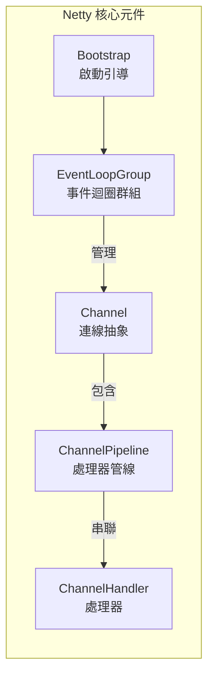
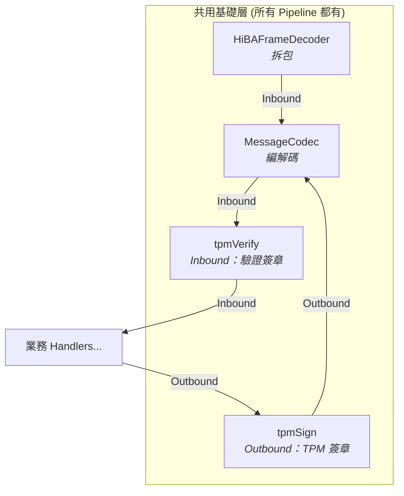
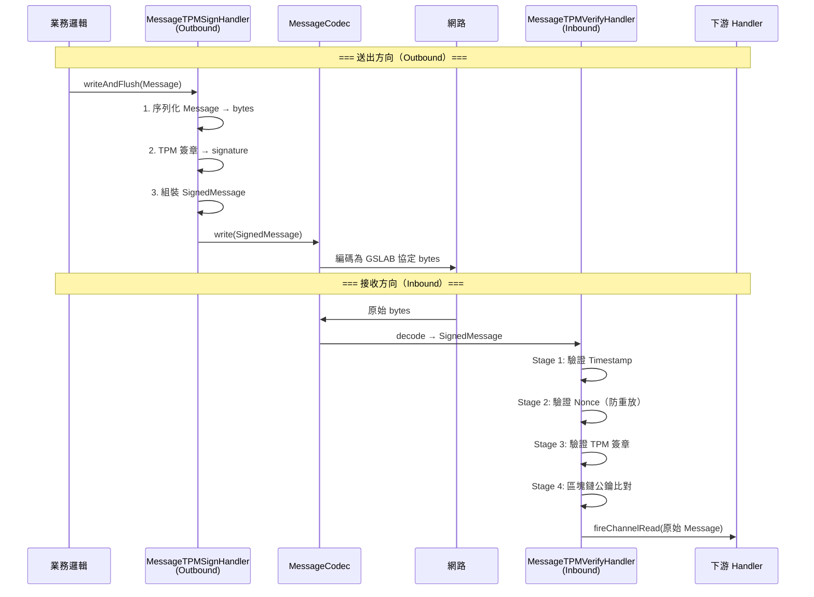
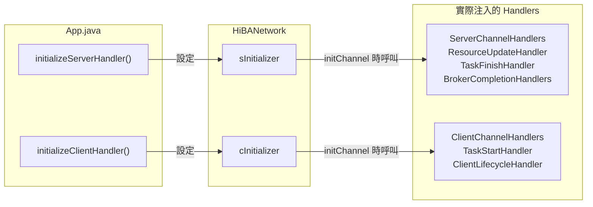
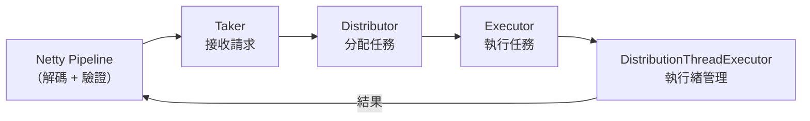

# HiBA Netty Pipeline 架構說明

> 本文件說明 HiBA 專案中 Netty 的核心理念與 Channel Pipeline 設計。

---

## 1. Netty 核心概念

### 1.1 什麼是 Netty

Netty 是一個 **非同步事件驅動（Asynchronous Event-Driven）** 的網路應用框架，用於快速開發高效能、高可靠性的網路伺服器與客戶端程式。

### 1.2 為什麼 HiBA 選擇 Netty

| 需求 | Netty 如何滿足 |
|------|----------------|
| 多節點即時通訊 | NIO 非阻塞 I/O，支撐 10+ 節點同時連線 |
| 自定義協定 | Pipeline 機制可輕鬆實現自定義編解碼 |
| 安全性 | Pipeline 插入 TPM 簽章/驗證無需改動業務邏輯 |
| 效能 | EventLoop 執行緒模型避免每連線一執行緒的開銷 |

### 1.3 核心元件



| 元件 | 說明 | HiBA 中的對應 |
|------|------|---------------|
| `EventLoopGroup` | 一組 EventLoop 執行緒，處理 I/O 事件 | `NioEventLoopGroup` (Boss + Worker) |
| `Channel` | 代表一個網路連線（Socket 抽象） | `NioSocketChannel` / `NioServerSocketChannel` |
| `ChannelPipeline` | 每個 Channel 的處理器鏈 | 見下方 §2 |
| `ChannelHandler` | 單一處理邏輯單元（編解碼、驗證等） | `MessageCodec`、`MessageTPMVerifyHandler` 等 |
| `Bootstrap` | 客戶端啟動引導 | `HiBANetwork` 建構子 |
| `ServerBootstrap` | 伺服端啟動引導 | `HiBANetwork.startServer()` |

---

## 2. Pipeline 設計理念

### 2.1 什麼是 Pipeline

Pipeline 是 Netty 的核心設計模式，本質上是一個 **雙向責任鏈（Chain of Responsibility）**：

```
                           ChannelPipeline
┌──────────────────────────────────────────────────────────────┐
│                                                              │
│  Inbound（讀取方向）   ════════════════════════►              │
│                                                              │
│  ┌─────────┐    ┌─────────┐    ┌─────────┐    ┌─────────┐   │
│  │Handler 1│───▶│Handler 2│───▶│Handler 3│───▶│Handler N│   │
│  └─────────┘    └─────────┘    └─────────┘    └─────────┘   │
│                                                              │
│  Outbound（寫入方向）  ◄════════════════════════             │
│                                                              │
└──────────────────────────────────────────────────────────────┘
```

- **Inbound Handler**：處理「接收到的」資料（解碼、驗證）—— 從左到右
- **Outbound Handler**：處理「要送出的」資料（簽章、編碼）—— 從右到左
- 每個 Handler **只負責一件事**，符合單一職責原則（SRP）

### 2.2 Pipeline 的優勢

1. **關注點分離**：協定解析、安全驗證、業務邏輯分層處理
2. **可插拔**：新增/移除 Handler 不影響其他邏輯（例如開關 TPM 簽章只需一個 flag）
3. **可測試**：每個 Handler 可獨立單測
4. **透明安全層**：業務 Handler 完全不知道 TPM 簽章的存在

---

## 3. HiBA 的 Pipeline 實作

### 3.1 自定義協定格式

HiBA 使用自定義二進位協定，透過 `MessageCodec` 實作：

```
┌─────────────┬─────────┬────────────┬────────────┬────────────┬──────────┬────────────────┐
│ Magic Number│ Version │ Serializer │ Msg Type   │ SequenceId │  Length  │    Body        │
│   5 bytes   │ 1 byte  │  1 byte    │  1 byte    │  4 bytes   │ 4 bytes  │  N bytes       │
│  "GSLAB"    │   0x01  │   0x01     │   0x01     │            │          │ Java序列化物件  │
└─────────────┴─────────┴────────────┴────────────┴────────────┴──────────┴────────────────┘
                                     ◄─── Header: 16 bytes ──────────────►
```

| 欄位 | 大小 | 說明 | 對應程式碼 |
|------|------|------|-----------|
| Magic Number | 5 bytes | 固定 `GSLAB` 辨識協定 | `MessageCodec.encode()` |
| Version | 1 byte | 協定版本（目前固定 1） | |
| Serializer | 1 byte | 序列化方式（1 = Java ObjectStream） | |
| Msg Type | 1 byte | 訊息類型（目前固定 1） | |
| SequenceId | 4 bytes | 訊息序號 | `msg.getSequenceId()` |
| Length | 4 bytes | Body 長度 | |
| Body | N bytes | Java 序列化後的 Message 物件 | |

**拆包處理**：`HiBAFrameDecoder` 繼承 `LengthFieldBasedFrameDecoder`，防止 TCP 粘包/拆包問題。

```java
// HiBAFrameDecoder.java
MAX_FRAME_LENGTH    = 30720  // 最大幀長 30KB
LENGTH_FIELD_OFFSET = 12     // Length 欄位偏移量（前 12 bytes 是 header 前半）
LENGTH_FIELD_LENGTH = 4      // Length 欄位長度
```

### 3.2 三種 Pipeline 配置

HiBA 有三種不同場景的 Pipeline，但都共享相同的**基礎層**：



---

#### Pipeline ① — Server 端（`startServer`）

Accounting Server 或 Broker 接受下層節點連線時使用：

```
HiBAFrameDecoder
    │
    ▼
MessageCodec
    │
    ▼
MessageTPMVerifyHandler (Inbound)  ← 驗證接收到的 SignedMessage
    │
MessageTPMSignHandler  (Outbound) ← 送出前自動簽章
    │
    ▼
LoginMessage Handler              ← 處理節點登入
    │
    ▼
connectionTest Handler            ← 連線測試回應
    │
    ▼
lowerBrokerScans Handler          ← 下層 Broker 掃描回應
    │
    ▼
GetBrokerName Handler             ← 回覆 Broker 名稱
    │
    ▼
GetBrokerList Handler             ← 回覆 Broker 清單
    │
    ▼
createReverseChannel Handler      ← 建立反向通道
    │
    ▼
TierCheck Handler                 ← 階層確認
    │
    ▼
MulticastBrokerSelector           ← Multicast Broker 選擇 (Node only)
    │
    ▼
KeepAliver                        ← 心跳保活
    │
    ▼
sInitializer.initial(channel)     ← App 注入的業務 Handler
    │
    ▼
channelInactive Handler           ← 斷線清理
    │
    ▼
exceptionCaught Handler           ← 例外處理（靜默）
```

> **`sInitializer`** 是 `App.initializeServerHandler()` 注入的 Hook，用於加入業務層 Handler（如 `ServerChannelHandlers` 中的 `ResourceUpdateHandler`、`TaskFinishHandler` 等）。

---

#### Pipeline ② — Client 端（`clientBootstrap`）

Node 連線至上層 Broker 時使用：

```
HiBAFrameDecoder
    │
    ▼
MessageCodec
    │
    ▼
MessageTPMVerifyHandler (Inbound)
    │
MessageTPMSignHandler  (Outbound)
    │
    ▼
channelActive Handler     ← 連線後自動發送 Login + GetBrokerName
    │
    ▼
GetBrokerNameResponse Handler  ← 紀錄 Broker 名稱
    │
    ▼
BrokerKeepAliver          ← Broker 心跳
    │
    ▼
AcctServerKeepAliver      ← Accounting Server 心跳
    │
    ▼
cInitializer.initial(channel) ← App 注入的業務 Handler
    │
    ▼
exceptionCaught Handler
```

> **`cInitializer`** 是 `App.initializeClientHandler()` 注入的 Hook，用於加入 `ClientChannelHandlers` 中的 `TaskStartHandler` 等。

---

#### Pipeline ③ — 臨時連線（`sendMessage` / `sendConnectMessage`）

發送單次訊息時建立的短暫連線：

```
HiBAFrameDecoder
    │
    ▼
MessageCodec
    │
    ▼
MessageTPMVerifyHandler (Inbound)
    │
MessageTPMSignHandler  (Outbound)
    │
    ▼
channelActive  ← 連線後立即發送訊息
    │
    ▼
channelRead    ← 接收回應
    │
    ▼
channelReadComplete ← 讀完後關閉連線
```

---

### 3.3 TPM 安全層詳解

TPM 安全層是 Pipeline 中最關鍵的設計，透過兩個 Handler 實現**透明簽章與驗證**：



#### MessageTPMSignHandler（Outbound）

| 步驟 | 動作 | 說明 |
|------|------|------|
| 1 | `serializeMessage(msg)` | 將 `Message` 物件序列化為 `byte[]` |
| 2 | `tpmService.sign(bytes)` | 呼叫 TPM 硬體進行簽章 |
| 3 | 組裝 `SignedMessage` | 含 messageData, signature, publicKey, timestamp, nonce, deviceId |
| 4 | `ctx.write(signedMessage)` | 傳遞給 `MessageCodec` 編碼送出 |

> **設計亮點**：業務程式碼只需 `writeAndFlush(new TaskStartMessage(...))`，完全不需要知道 TPM 簽章的存在。

#### MessageTPMVerifyHandler（Inbound）

| 驗證階段 | 驗證內容 | 失敗處理 |
|----------|----------|----------|
| Stage 1 | **Timestamp** — 時間戳是否在容許範圍內 | 拒絕訊息 |
| Stage 2 | **Nonce** — 是否為全新的 nonce（防重放攻擊） | 拒絕訊息 |
| Stage 3 | **TPM 簽章** — 使用公鑰驗證資料完整性 | 拒絕訊息 |
| Stage 4 | **區塊鏈公鑰** — 從鏈上查詢裝置公鑰進行比對 | 依模式決定 |

驗證模式（`VerificationMode`）：

| 模式 | 說明 |
|------|------|
| `MESSAGE_ONLY` | 只使用訊息內附帶的公鑰 |
| `BLOCKCHAIN_ONLY` | 只使用區塊鏈上的公鑰 |
| `BLOCKCHAIN_PREFERRED` | 優先使用區塊鏈公鑰，失敗時 fallback 到訊息公鑰 |

### 3.4 Initializer Hook 機制

`HiBANetwork` 使用 **Initializer 介面** 讓 `App` 可以動態注入業務層 Handler：

```java
// SdnNetwork 介面定義
void clientInitialHandler(Initializer initializer);
void serverInitialHandler(Initializer initializer);
```



這讓 **網路層（HiBANetwork）和業務層（App）解耦**：
- `HiBANetwork` 只負責連線管理和基礎協定
- `App` 透過 Initializer 注入自己的業務處理邏輯

---

## 4. 與 mService 的關係

Pipeline 接收到的訊息最終會進入 mService 微服務管線：



具體流程：
1. Client Pipeline 收到 `TaskStartMessage` → 交給 `TaskStartHandler`
2. `TaskStartHandler` 將任務放入 `requestQueue`
3. `DistributionThreadExecutor` 從 queue 取出任務
4. 呼叫對應 `Executor` 執行
5. 執行結果透過 Pipeline 回傳 `TaskFinishMessage`

---

## 5. 關鍵類別速查

| 類別 | 類型 | 所在套件 | 職責 |
|------|------|----------|------|
| `HiBANetwork` | 核心 | `sdns` | Netty Server/Client 啟動、Pipeline 組裝、連線管理 |
| `HiBAFrameDecoder` | Handler | `protocol` | TCP 拆包（LengthFieldBasedFrameDecoder） |
| `MessageCodec` | Handler | `protocol` | GSLAB 協定編解碼（Header + Java 序列化） |
| `MessageTPMSignHandler` | Outbound | `handlers` | 訊息 TPM 自動簽章 |
| `MessageTPMVerifyHandler` | Inbound | `handlers` | 訊息 TPM 四階段驗證 |
| `TimestampValidator` | 工具 | `handlers` | Stage 1 — 時間戳驗證 |
| `NonceValidator` | 工具 | `handlers` | Stage 2 — Nonce 防重放 |
| `ServerChannelHandlers` | Handler 集合 | `handlers` | Server 端業務 Handler（資源更新、任務完成等） |
| `ClientChannelHandlers` | Handler 集合 | `handlers` | Client 端業務 Handler（任務啟動、生命週期等） |
| `BrokerCompletionHandlers` | Handler 集合 | `handlers` | Broker 任務完成處理 |
| `BrokerRegistrationHandlers` | Handler 集合 | `handlers` | Broker 註冊處理 |

---

## 6. 設計模式總結

| 模式 | 在 HiBA 中的體現 |
|------|-------------------|
| **Chain of Responsibility** | Pipeline 本身 — Handler 依序傳遞 |
| **Decorator / Interceptor** | TPM Sign/Verify Handler — 透明包裝訊息 |
| **Observer** | EventLoop — 非同步事件通知 |
| **Strategy** | `VerificationMode` — 公鑰選取策略 |
| **Template Method** | `SimpleChannelInboundHandler<T>` — 型別過濾 + 處理模板 |
| **Hook / Plugin** | `Initializer` — App 動態注入 Handler |
