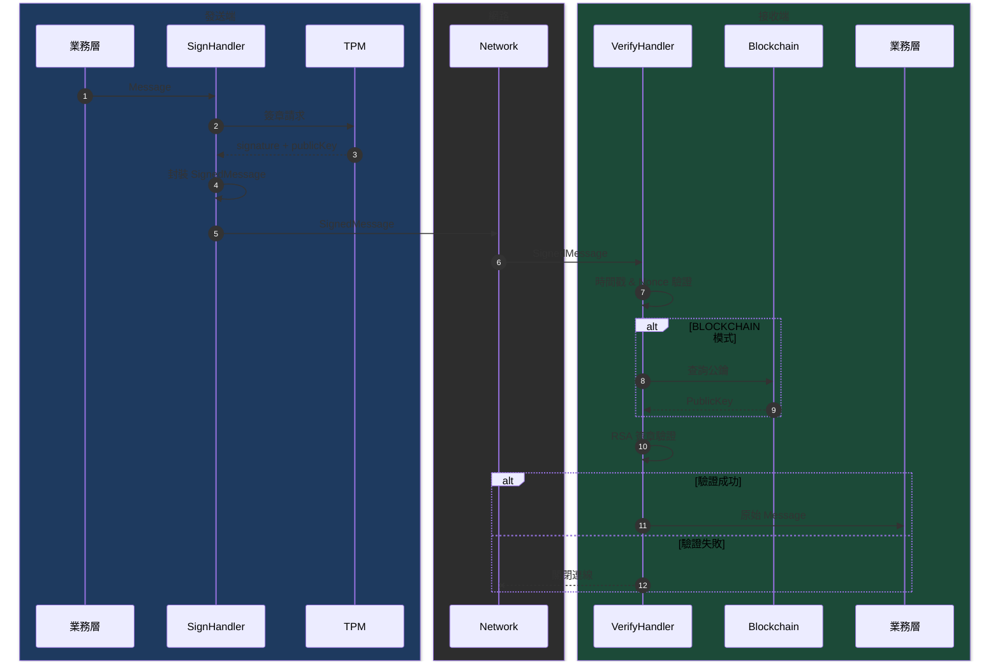
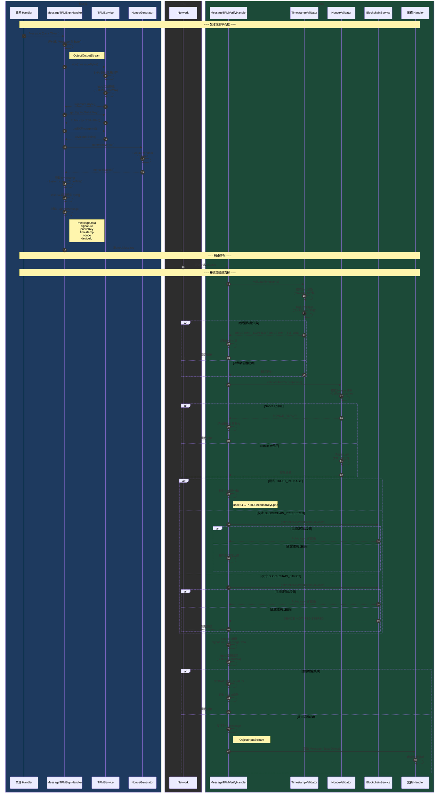

# TPM Message Handlers 說明文件

## 概述

本文件說明 HiBA 系統中用於 TPM（Trusted Platform Module）訊息簽章與驗證的兩個核心 Handler：

- **MessageTPMSignHandler**：Outbound Handler，負責在訊息發送前進行 TPM 簽章
- **MessageTPMVerifyHandler**：Inbound Handler，負責驗證接收到的 TPM 簽章訊息

這兩個 Handler 基於 Netty Channel Pipeline 機制，實現端對端的訊息完整性與來源驗證。

---

## 架構圖

### Netty Pipeline 位置

```
發送端 (Outbound)：
┌─────────────┐    ┌─────────────────────┐    ┌──────────────┐    ┌──────────────┐
│  業務Handler │ → │ MessageTPMSignHandler│ → │ MessageCodec │ → │ FrameEncoder │ → 網路
└─────────────┘    └─────────────────────┘    └──────────────┘    └──────────────┘

接收端 (Inbound)：
網路 → ┌──────────────┐    ┌──────────────┐    ┌───────────────────────┐    ┌─────────────┐
       │ FrameDecoder │ → │ MessageCodec │ → │ MessageTPMVerifyHandler│ → │  業務Handler │
       └──────────────┘    └──────────────┘    └───────────────────────┘    └─────────────┘
```

---

## MessageTPMSignHandler（簽章處理器）

### 功能說明

`MessageTPMSignHandler` 是一個 **Outbound Handler**，負責在 `Message` 物件發送到網路之前，使用 TPM 硬體進行數位簽章。

### 處理流程

```
                                   MessageTPMSignHandler
                                   ┌────────────────────────────────────────────────────┐
                                   │                                                    │
   Message 物件                    │  1. 序列化 Message 為 bytes                        │
   ──────────────────────────────▶ │  2. TPM 對 bytes 進行 RSA 簽章                     │
                                   │  3. 取得公鑰、設備 ID、版本資訊                     │
                                   │  4. 產生時間戳與 Nonce                             │
                                   │  5. 封裝成 SignedMessage                          │
                                   │                                                    │
                                   └──────────────────────────────────────────▶─────────┘
                                                                              SignedMessage 物件
```

### 詳細步驟

#### 步驟 1：序列化 Message

```java
// 使用 Java ObjectOutputStream 將 Message 物件轉為 byte[]
ByteArrayOutputStream bos = new ByteArrayOutputStream();
ObjectOutputStream oos = new ObjectOutputStream(bos);
oos.writeObject(originalMessage);
byte[] messageBytes = bos.toByteArray();
```

**資料內容**：
- 輸入：任意 `Message` 子類別物件
- 輸出：序列化後的 `byte[]`

#### 步驟 2：TPM 簽章

```java
// 使用 TPM 硬體對資料進行簽章
byte[] signature = tpmService.sign(messageBytes);
```

**簽章演算法**：`SHA256withRSA`（RSASSA-PKCS1-v1.5-SHA256）

**處理流程**：
1. 計算 `messageBytes` 的 SHA-256 雜湊值
2. 使用 TPM 內部儲存的 RSA 私鑰對雜湊值進行簽章
3. 私鑰永遠不離開 TPM 硬體

#### 步驟 3：取得 TPM 資訊

```java
PublicKey publicKey = tpmService.getSigningPublicKey();  // RSA 公鑰
String ekFingerprint = tpmService.getEKFingerprint();    // 設備唯一識別碼
String tpmVersion = tpmService.getTpmVersion();          // TPM 版本 (如 "2.0")
```

#### 步驟 4：產生時間戳與 Nonce

```java
long timestamp = System.currentTimeMillis();             // 當前時間（毫秒）
String nonce = NonceValidator.generateNonce();           // 16 bytes 隨機數，Base64 編碼
```

**Nonce 產生方式**：
```java
byte[] nonceBytes = new byte[16];  // 128 bits
SecureRandom.nextBytes(nonceBytes);
String nonce = Base64.getUrlEncoder().withoutPadding().encodeToString(nonceBytes);
```

#### 步驟 5：封裝 SignedMessage

```java
SignedMessage signedMessage = new SignedMessage()
    .setMessageData(Base64.getEncoder().encodeToString(messageBytes))
    .setMessageClassName(originalMessage.getClass().getName())
    .setSignature(Base64.getEncoder().encodeToString(signature))
    .setPublicKey(Base64.getEncoder().encodeToString(publicKey.getEncoded()))
    .setSignatureAlgorithm("SHA256withRSA")
    .setTimestamp(timestamp)
    .setNonce(nonce)
    .setDeviceId(ekFingerprint)
    .setTpmVersion(tpmVersion);
```

---

## SignedMessage 資料結構

`SignedMessage` 是簽章後的訊息封裝，包含以下欄位：

| 欄位名稱 | 類型 | 說明 | 範例值 |
|---------|------|------|--------|
| `messageData` | String | 原始 Message 序列化後的 Base64 編碼 | `"rO0ABXNyAB9vcmcuZ3NsYWIu..."` |
| `messageClassName` | String | 原始 Message 的完整類別名稱 | `"org.gslab.message_hiba.GetFileMessage"` |
| `signature` | String | TPM 簽章的 Base64 編碼 | `"MEUCIQD2..."` |
| `publicKey` | String | TPM 公鑰的 Base64 編碼（X.509 格式） | `"MIIBIjAN..."` |
| `signatureAlgorithm` | String | 簽章演算法名稱 | `"SHA256withRSA"` |
| `timestamp` | long | 簽章時間（Unix 時間戳，毫秒） | `1733644800000` |
| `nonce` | String | 防重放攻擊的隨機數（Base64 編碼） | `"xK9mN2pQ8rT1uV3w"` |
| `deviceId` | String | TPM 設備 ID（EK Fingerprint） | `"a1b2c3d4e5f6..."` |
| `tpmVersion` | String | TPM 版本 | `"2.0"` |

### 序列化格式

```
SignedMessage (繼承自 Message)
├── messageData: String (Base64)
│   └── 內容: 原始 Message 的 Java 序列化 bytes
├── messageClassName: String
├── signature: String (Base64)
│   └── 內容: RSA 簽章 bytes (256 bytes for RSA-2048)
├── publicKey: String (Base64)
│   └── 內容: X.509 編碼的 RSA 公鑰
├── signatureAlgorithm: String
├── timestamp: long
├── nonce: String (Base64)
├── deviceId: String
└── tpmVersion: String
```

---

## MessageTPMVerifyHandler（驗證處理器）

### 功能說明

`MessageTPMVerifyHandler` 是一個 **Inbound Handler**，負責驗證接收到的 `SignedMessage` 的 TPM 簽章。

### 驗證模式

| 模式 | 說明 | 安全等級 |
|------|------|----------|
| `TRUST_PACKAGE` | 信任封包內的公鑰進行驗證 | ⭐⭐ 中 |
| `BLOCKCHAIN_PREFERRED` | 優先使用區塊鏈公鑰，若無則使用封包公鑰 | ⭐⭐⭐ 高 |
| `BLOCKCHAIN_STRICT` | 必須使用區塊鏈上已註冊的公鑰 | ⭐⭐⭐⭐ 最高 |

### 處理流程

```
                                MessageTPMVerifyHandler
                                ┌──────────────────────────────────────────────────────────┐
                                │                                                          │
  SignedMessage 物件            │  1. 驗證時間戳（防止過期訊息）                            │
  ────────────────────────────▶ │  2. 驗證 Nonce（防止重放攻擊）                           │
                                │  3. 取得驗證用公鑰（根據模式）                            │
                                │  4. 解碼簽章與原始資料                                   │
                                │  5. 驗證 RSA 簽章                                       │
                                │  6. 反序列化還原原始 Message                             │
                                │                                                          │
                                └────────────────────────────────────────────────▶─────────┘
                                                                                原始 Message 物件
```

### 詳細步驟

#### 步驟 1：時間戳驗證

```java
MessageVerificationResult timestampResult = timestampValidator.validate(signedMessage.getTimestamp());
```

**驗證邏輯**：
```
當前時間 - 訊息時間戳 = 時間差

if (時間差 > maxAgeMs)           → 訊息過期，拒絕
if (時間差 < -clockSkewMs)       → 訊息在未來，拒絕（時鐘偏移超出容許範圍）
otherwise                         → 通過
```

**預設配置**：
| 參數 | 預設值 | 說明 |
|------|--------|------|
| `maxAgeMs` | 300,000 (5 分鐘) | 訊息最大有效期 |
| `clockSkewMs` | 30,000 (30 秒) | 允許的時鐘偏移 |

#### 步驟 2：Nonce 驗證

```java
MessageVerificationResult nonceResult = nonceValidator.validateAndRecord(signedMessage.getNonce());
```

**驗證邏輯**：
1. 檢查 Nonce 是否已在快取中（已使用過）
2. 若已使用 → 可能是重放攻擊，拒絕
3. 若未使用 → 記錄到快取，通過

**快取配置**：
| 參數 | 值 | 說明 |
|------|-----|------|
| 過期時間 | 10 分鐘 | 應大於時間戳最大有效期 |
| 最大快取大小 | 100,000 筆 | 使用 Caffeine Cache |

#### 步驟 3：取得驗證用公鑰

根據驗證模式選擇公鑰來源：

**TRUST_PACKAGE 模式**：
```java
byte[] publicKeyBytes = Base64.getDecoder().decode(signedMessage.getPublicKey());
X509EncodedKeySpec keySpec = new X509EncodedKeySpec(publicKeyBytes);
KeyFactory keyFactory = KeyFactory.getInstance("RSA");
PublicKey verificationKey = keyFactory.generatePublic(keySpec);
```

**BLOCKCHAIN_STRICT 模式**：
```java
PublicKey verificationKey = blockchainService.getPublicKeyWithCache(ekFingerprint).orElse(null);
// 若區塊鏈查無此設備 → 拒絕訊息
```

**BLOCKCHAIN_PREFERRED 模式**：
```java
Optional<PublicKey> blockchainKey = blockchainService.getPublicKeyWithCache(deviceId);
if (blockchainKey.isPresent()) {
    return blockchainKey.get();  // 優先使用區塊鏈公鑰
}
return extractPublicKeyFromMessage(signedMessage);  // 否則使用封包公鑰
```

#### 步驟 4：解碼簽章與原始資料

```java
byte[] signature = Base64.getDecoder().decode(signedMessage.getSignature());
byte[] messageData = Base64.getDecoder().decode(signedMessage.getMessageData());
```

#### 步驟 5：驗證 RSA 簽章

```java
boolean verified = TPMService.verifyWithJavaCrypto(verificationKey, messageData, signature);
```

**驗證流程**：
1. 使用 Java Crypto API 的 `Signature` 類別
2. 初始化為 `SHA256withRSA` 演算法
3. 使用公鑰驗證簽章是否匹配原始資料
4. 回傳驗證結果（true/false）

#### 步驟 6：反序列化 Message

```java
ByteArrayInputStream bis = new ByteArrayInputStream(messageData);
ObjectInputStream ois = new ObjectInputStream(bis);
Message originalMessage = (Message) ois.readObject();
```

---

## 完整資料流程圖

### Mermaid 訊息序列圖（簡化版）



### Mermaid 訊息序列圖（完整版）



### 簡化流程圖


### 原始 ASCII 流程圖

```
發送端                                                                接收端
┌──────────────────────────────────────────┐                      ┌──────────────────────────────────────────┐
│                                          │                      │                                          │
│  ┌─────────────────┐                     │                      │                     ┌─────────────────┐  │
│  │  原始 Message   │                     │                      │                     │  原始 Message   │  │
│  │  (Java Object)  │                     │                      │                     │  (Java Object)  │  │
│  └────────┬────────┘                     │                      │                     └────────▲────────┘  │
│           │                              │                      │                              │           │
│           ▼                              │                      │                              │           │
│  ┌─────────────────┐                     │                      │     ┌─────────────────────────┘           │
│  │   序列化為      │                     │                      │     │                                     │
│  │   byte[]        │                     │                      │     │ 6. 反序列化為 Message               │
│  └────────┬────────┘                     │                      │     │                                     │
│           │                              │                      │  ┌──┴──────────────┐                      │
│           ▼                              │                      │  │ 5. RSA 簽章驗證 │                      │
│  ┌─────────────────┐                     │                      │  │   (SHA256withRSA)│                      │
│  │ TPM RSA 簽章    │                     │                      │  └────────▲────────┘                      │
│  │ (SHA256withRSA) │                     │                      │           │                              │
│  └────────┬────────┘                     │                      │           │                              │
│           │                              │                      │  ┌────────┴────────┐                      │
│           ▼                              │                      │  │ 4. Base64 解碼  │                      │
│  ┌─────────────────┐                     │                      │  │   signature     │                      │
│  │ 產生 Nonce     │                     │                      │  │   messageData   │                      │
│  │ (16 bytes 隨機) │                     │                      │  └────────▲────────┘                      │
│  └────────┬────────┘                     │                      │           │                              │
│           │                              │                      │  ┌────────┴────────┐                      │
│           ▼                              │                      │  │ 3. 取得公鑰     │                      │
│  ┌─────────────────┐                     │                      │  │ (封包/區塊鏈)  │                      │
│  │ 記錄時間戳      │                     │                      │  └────────▲────────┘                      │
│  │ (毫秒)          │                     │                      │           │                              │
│  └────────┬────────┘                     │                      │  ┌────────┴────────┐                      │
│           │                              │                      │  │ 2. Nonce 驗證   │                      │
│           ▼                              │                      │  │ (防重放攻擊)    │                      │
│  ┌─────────────────┐                     │                      │  └────────▲────────┘                      │
│  │ Base64 編碼     │                     │                      │           │                              │
│  │ 所有 byte[]     │                     │                      │  ┌────────┴────────┐                      │
│  └────────┬────────┘                     │                      │  │ 1. 時間戳驗證   │                      │
│           │                              │                      │  │ (防過期訊息)    │                      │
│           ▼                              │                      │  └────────▲────────┘                      │
│  ┌─────────────────┐                     │       網路傳輸       │           │                              │
│  │  SignedMessage  │─────────────────────┼─────────────────────▶│  ┌────────┴────────┐                      │
│  │  (Java Object)  │                     │                      │  │  SignedMessage  │                      │
│  └─────────────────┘                     │                      │  │  (Java Object)  │                      │
│                                          │                      │  └─────────────────┘                      │
└──────────────────────────────────────────┘                      └──────────────────────────────────────────┘
```

---

## 安全機制說明

### 1. 訊息完整性（Integrity）

- 使用 `SHA256withRSA` 簽章演算法
- 任何對 `messageData` 的竄改都會導致簽章驗證失敗

### 2. 來源認證（Authentication）

| 模式 | 認證方式 |
|------|----------|
| TRUST_PACKAGE | 信任封包內公鑰，無法驗證發送者身份 |
| BLOCKCHAIN_PREFERRED | 優先透過區塊鏈驗證設備是否已註冊 |
| BLOCKCHAIN_STRICT | 強制要求設備在區塊鏈註冊，否則拒絕 |

### 3. 防重放攻擊（Replay Attack Prevention）

- **時間戳驗證**：訊息超過 5 分鐘自動過期
- **Nonce 驗證**：每個 Nonce 只能使用一次，10 分鐘內重複使用會被拒絕

### 4. TPM 硬體安全

- 私鑰永遠儲存在 TPM 硬體內，無法被軟體提取
- 簽章操作在 TPM 內完成，防止中間人攻擊
- EK (Endorsement Key) 提供設備唯一識別

---

## 配置選項

### MessageVerificationConfig

```java
// 預設配置
MessageVerificationConfig.defaultConfig()

// 寬鬆配置（測試用）
MessageVerificationConfig.relaxedConfig()
// maxAgeMs = 30 分鐘, clockSkewMs = 1 分鐘

// 嚴格配置（高安全性場景）
MessageVerificationConfig.strictConfig()
// maxAgeMs = 1 分鐘, clockSkewMs = 10 秒

// 自訂配置
MessageVerificationConfig.builder()
    .maxAgeMs(10 * 60 * 1000L)       // 10 分鐘
    .clockSkewMs(60 * 1000L)         // 1 分鐘
    .timestampValidationEnabled(true)
    .nonceValidationEnabled(true)
    .sendErrorResponse(true)
    .build();
```

---

## 使用範例

### 初始化 Handlers

```java
// 發送端 - 簽章 Handler
TPMService tpmService = new TPMService();
tpmService.createSigningKey();
MessageTPMSignHandler signHandler = new MessageTPMSignHandler(tpmService);

// 接收端 - 驗證 Handler（信任封包模式）
MessageTPMVerifyHandler verifyHandler = new MessageTPMVerifyHandler();

// 接收端 - 驗證 Handler（區塊鏈模式）
Web3BlockchainService blockchainService = new Web3BlockchainService(...);
MessageTPMVerifyHandler verifyHandler = new MessageTPMVerifyHandler(
    VerificationMode.BLOCKCHAIN_STRICT,
    blockchainService
);
```

### 加入 Pipeline

```java
// 發送端 Pipeline
pipeline.addLast("frameEncoder", new LengthFieldPrepender(4));
pipeline.addLast("messageCodec", new MessageCodec());
pipeline.addLast("tpmSign", new MessageTPMSignHandler(tpmService));
pipeline.addLast("businessHandler", new MyBusinessHandler());

// 接收端 Pipeline
pipeline.addLast("frameDecoder", new LengthFieldBasedFrameDecoder(...));
pipeline.addLast("messageCodec", new MessageCodec());
pipeline.addLast("tpmVerify", new MessageTPMVerifyHandler());
pipeline.addLast("businessHandler", new MyBusinessHandler());
```

---

## 錯誤處理

### 驗證失敗錯誤碼

| 錯誤碼 | 說明 |
|--------|------|
| `TIMESTAMP_EXPIRED` | 訊息時間戳已過期 |
| `TIMESTAMP_FUTURE` | 訊息時間戳在未來（超出時鐘偏移容許範圍） |
| `NONCE_REPLAY` | Nonce 重複使用（可能是重放攻擊） |
| `SIGNATURE_INVALID` | 簽章驗證失敗（資料可能被竄改） |
| `DEVICE_NOT_REGISTERED` | 設備未在區塊鏈註冊（BLOCKCHAIN_STRICT 模式） |
| `PARSE_ERROR` | 資料解析錯誤 |

### 驗證失敗處理

當驗證失敗時，Handler 會：
1. 記錄警告日誌
2. 根據配置選擇是否發送錯誤回應
3. 關閉連線

---

## 相關檔案

| 檔案 | 說明 |
|------|------|
| `MessageTPMSignHandler.java` | 簽章 Handler |
| `MessageTPMVerifyHandler.java` | 驗證 Handler |
| `SignedMessage.java` | 簽章訊息封裝類別 |
| `TPMService.java` | TPM 服務封裝 |
| `NonceValidator.java` | Nonce 驗證器 |
| `TimestampValidator.java` | 時間戳驗證器 |
| `MessageVerificationConfig.java` | 驗證配置 |

---

## 版本資訊

- 文件建立日期：2025-12-08
- TPM 版本：2.0
- 簽章演算法：SHA256withRSA (RSASSA-PKCS1-v1.5)
- 金鑰長度：RSA-2048
