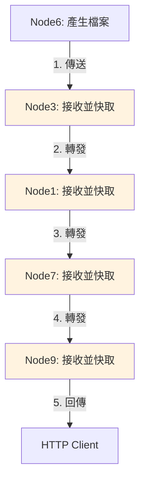
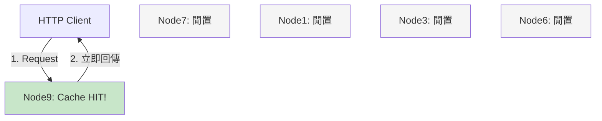
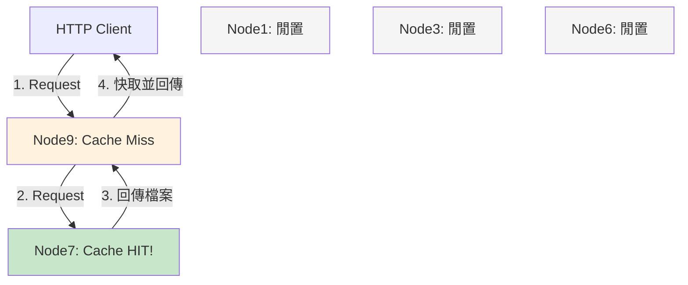
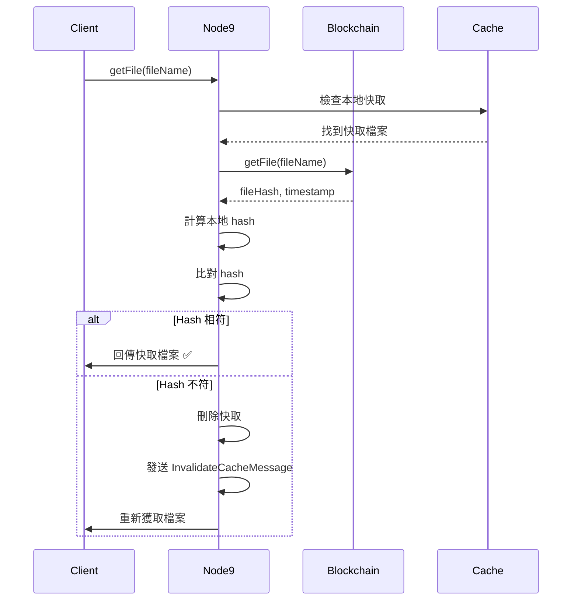
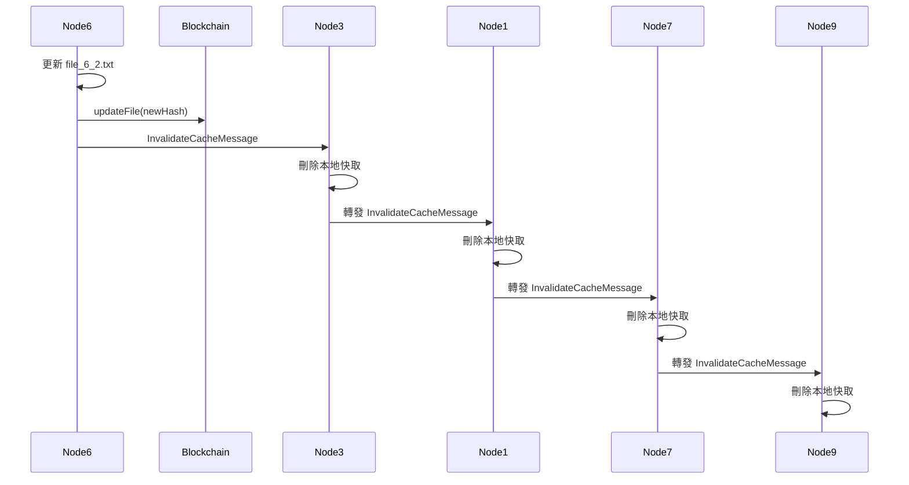
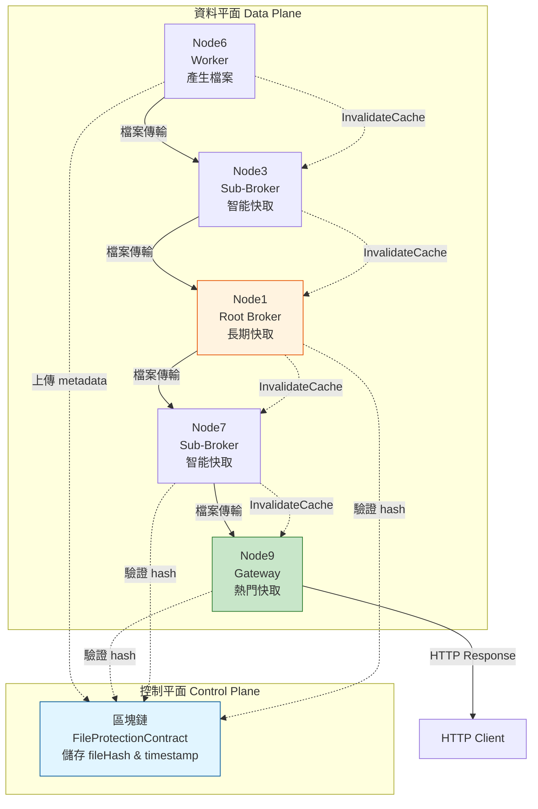

# Hiba-Node 分散式快取策略設計文件
## 結合區塊鏈驗證與路徑快取的去中心化方案

**文件版本：** v1.0  
**最後更新：** 2025年11月10日  
**作者：** Mark  
**目的：** 為 hiba-node 分散式系統設計一套高效能、去中心化的檔案快取策略，結合區塊鏈驗證機制確保資料完整性

---

## 目錄

1. [背景與問題分析](#1-背景與問題分析)
2. [設計目標與限制](#2-設計目標與限制)
3. [核心解決方案](#3-核心解決方案)
4. [TTL 策略分析](#4-ttl-策略分析)
5. [混合架構設計](#5-混合架構設計)
6. [實作細節](#6-實作細節)
7. [效能優化策略](#7-效能優化策略)
8. [監控與維護](#8-監控與維護)
9. [實作階段規劃](#9-實作階段規劃)
10. [總結與評估](#10-總結與評估)

---

## 1. 背景與問題分析

### 1.1 當前系統架構

Hiba-node 系統採用多層級的分散式架構：

```
HTTP Client
    ↓
Node9 (Gateway)
    ↓
Node7 (Sub-Broker)
    ↓
Node1 (Root Broker)
    ↓
Node3 (Sub-Broker)
    ↓
Node6 (Worker)
```

### 1.2 核心問題：資料平面的傳輸瓶頸

根據日誌分析 `[2025-11-10T03:56:58.115Z]`，當前系統存在以下問題：

#### 問題 1: 逐跳儲存轉發 (Store-and-Forward)

檔案傳輸路徑：
```
Node6 → Node3 → Node1 → Node7 → Node9 → Client
```

**時間消耗分析：**
- `03:56:58.206` - Node6 完成檔案產生
- `03:56:59.199` - Node1 開始接收檔案
- `03:57:00.149` - Node7 開始接收檔案
- `03:57:00.311` - Node9 開始接收檔案
- **總耗時：約 2 秒**

#### 問題 2: 中間節點負載

每個中間節點都需要：
1. 接收完整檔案
2. 儲存到本地磁碟 (`receiveFile/...` 目錄)
3. 再轉發給下一跳

**資源消耗：**
- I/O 負擔：每個節點都寫入磁碟
- 網路頻寬：多次完整傳輸
- 延遲累積：每一跳都增加延遲

#### 問題 3: 重複請求的效能浪費

如果多個 Client 請求相同檔案，整個傳輸鏈路會被重複執行。

### 1.3 區塊鏈整合現狀

系統已整合 `FileProtectionContract` 智能合約，用於：

```solidity
struct StoredFileMetadata {
    string id;
    string fileName;
    string fileHash;      // SHA-256 或類似
    string uploader;
    uint256 fileSize;
    string filePath;
    string description;
    uint256 timestamp;    // 上傳/更新時間
    bool exists;
}
```

**優勢：**
- ✅ 提供不可竄改的檔案 hash
- ✅ 記錄檔案元數據
- ✅ 可作為快取驗證的信任來源

---

## 2. 設計目標與限制

### 2.1 核心目標

1. **效能提升**
    - 減少端到端延遲至毫秒級
    - 降低中間節點的 I/O 負擔
    - 提高系統整體吞吐量

2. **去中心化**
    - 不依賴中心化 Redis/Memcached
    - 不使用中心化物件儲存 (S3/MinIO)
    - 完全基於節點自身能力

3. **安全性**
    - 確保快取資料完整性
    - 防止惡意節點提供假檔案
    - 支援快取驗證機制

4. **可維護性**
    - 自動失效機制
    - 監控與指標收集
    - 容錯與降級策略

### 2.2 系統限制

1. **檔案特性**
    - 類型：靜態大檔案
    - 更新頻率：未知，但不頻繁
    - 大小：可能從幾 MB 到數 GB

2. **網路環境**
    - 多層級 Broker 架構
    - 節點間通過 Netty 通訊
    - 支援 HTTP 和自定義協議

3. **儲存限制**
    - 避免 JVM 記憶體快取 (OOM 風險)
    - 使用本地磁碟快取
    - 需要空間管理策略

---

## 3. 核心解決方案

### 3.1 分散式路徑快取 (Distributed Path Caching)

**核心思想：** 凡是處理過該檔案的節點，都應該將其快取。

#### 3.1.1 首次請求：快取建立



**流程說明：**

1. **Node6** 產生 `file_6_2.txt`
2. **Node3** 收到檔案
    - ✅ 寫入本地磁碟快取 `/cache/getFile/file_6_2.txt`
    - ➡️ 轉發給 Node1
3. **Node1** 收到檔案
    - ✅ 寫入本地磁碟快取
    - ➡️ 轉發給 Node7
4. **Node7** 收到檔案
    - ✅ 寫入本地磁碟快取
    - ➡️ 轉發給 Node9
5. **Node9** 收到檔案
    - ✅ 寫入本地磁碟快取
    - ➡️ 回傳給 Client

#### 3.1.2 後續請求：快取命中

**情境 A：邊緣快取命中 (Edge Cache Hit) - 最快**



**效能：**
- ⚡ 延遲：< 10ms (僅本地磁碟讀取)
- 🎯 命中率：對熱門檔案可達 90%+
- 💾 資源：僅 Node9 負載

**情境 B：中間節點命中 (Intermediate Cache Hit)**



**效能：**
- ⚡ 延遲：50-100ms (Node7 → Node9)
- 🎯 繞過：Node1, Node3, Node6
- 💾 資源：僅 Node7 和 Node9 負載

### 3.2 區塊鏈驗證機制

**核心概念：** 使用區塊鏈上的 `fileHash` 作為快取驗證的信任來源。

#### 3.2.1 快取寫入時記錄 Hash

```java
class CachedFile {
    String fileName;           // 檔案名稱
    String fileHash;           // 從區塊鏈獲取的 hash
    String filePath;           // 本地快取路徑
    long blockchainTimestamp;  // 區塊鏈上的時間戳
    long cacheTimestamp;       // 快取寫入時間
    long fileSize;             // 檔案大小
    int accessCount;           // 存取次數（熱度）
}
```

#### 3.2.2 快取讀取時驗證完整性

```java
boolean isValid() {
    // 1. 檢查檔案是否存在
    File file = new File(filePath);
    if (!file.exists()) {
        return false;
    }
    
    // 2. 計算本地檔案的 hash
    String localHash = calculateSHA256(filePath);
    
    // 3. 與區塊鏈上的 hash 比對
    return localHash.equals(fileHash);
}
```

#### 3.2.3 驗證流程



---

## 4. TTL 策略分析

### 4.1 TTL 不適用的原因

對於你的系統，**不建議使用固定 TTL**，理由如下：

#### 問題 1: 更新頻率未知
```
如果設定 TTL = 1 小時：
- 檔案在第 5 分鐘更新
- 快取仍會存活 55 分鐘
- 用戶會拿到舊資料 ❌
```

#### 問題 2: 大檔案特性
```
大檔案 (1GB+) 的問題：
- 下載一次耗時很長（分鐘級）
- 如果 TTL 太短，頻繁重新下載
- 浪費網路頻寬和時間 ❌
```

#### 問題 3: 儲存空間浪費
```
如果 TTL = 24 小時：
- 冷門檔案會佔用快取 24 小時
- 無法及時釋放空間給熱門檔案 ❌
```

### 4.2 推薦策略：基於事件的失效

**策略一：區塊鏈時間戳驗證（輕量級）**

```java
public boolean shouldRefreshCache(String fileName, CachedFile cached) {
    // 只查詢 timestamp（Gas cost 極低）
    BigInteger blockchainTimestamp = contract.getFileTimestamp(fileName).send();
    
    // 如果區塊鏈時間戳更新了，表示檔案已更新
    if (blockchainTimestamp.longValue() > cached.blockchainTimestamp) {
        return true; // 需要重新獲取
    }
    
    return false; // 快取仍然有效
}
```

**優點：**
- ✅ 無需固定 TTL
- ✅ 每次存取時實時驗證
- ✅ Gas cost 低（僅讀取 uint256）

**策略二：主動失效通知（推薦）**

當檔案更新時，主動通知所有快取節點：



---

## 5. 混合架構設計

### 5.1 架構概覽

結合 **Gemini 的路徑快取** + **區塊鏈驗證機制**：



### 5.2 訊息類型定義

#### InvalidateCacheMessage

```java
public class InvalidateCacheMessage {
    private String requestId;         // 請求 ID
    private String fileName;          // 檔案名稱
    private String expectedHash;      // 來自區塊鏈的正確 hash
    private long blockchainTimestamp; // 區塊鏈時間戳
    private InvalidationReason reason;// 失效原因
    private String sourceNode;        // 發起節點
    
    public enum InvalidationReason {
        FILE_UPDATED,      // 檔案被更新
        FILE_DELETED,      // 檔案被刪除
        CORRUPTION,        // 檔案損壞
        BLOCKCHAIN_VERIFY, // 區塊鏈驗證失敗
        MANUAL             // 手動清除
    }
}
```

### 5.3 節點行為定義

#### Node9 (Gateway) - 邊緣快取

**責任：**
- 快取最熱門的小檔案
- 快速響應 Client 請求
- 第一道防線

**快取策略：**
```java
public class Node9CacheStrategy {
    private static final long MAX_CACHE_SIZE = 50L * 1024 * 1024 * 1024; // 50GB
    private static final long MAX_FILE_SIZE = 10 * 1024 * 1024;          // 10MB
    
    public boolean shouldCache(String fileName, long fileSize, int accessCount) {
        // 只快取小於 10MB 且被存取超過 5 次的檔案
        return fileSize < MAX_FILE_SIZE && accessCount > 5;
    }
}
```

#### Node7/Node3 (Sub-Broker) - 中間快取

**責任：**
- 快取中等大小的檔案
- 分擔 Root Broker 壓力
- 區域性快取

**快取策略：**
```java
public class SubBrokerCacheStrategy {
    private static final long MAX_CACHE_SIZE = 100L * 1024 * 1024 * 1024; // 100GB
    private static final long MAX_FILE_SIZE = 100 * 1024 * 1024;          // 100MB
    
    public boolean shouldCache(String fileName, long fileSize, int accessCount) {
        // 快取中等檔案且被存取超過 2 次
        return fileSize < MAX_FILE_SIZE && accessCount > 2;
    }
}
```

#### Node1 (Root Broker) - 長期快取

**責任：**
- 快取所有有價值的檔案
- 最後一道快取層
- 統計與監控中心

**快取策略：**
```java
public class RootBrokerCacheStrategy {
    private static final long MAX_CACHE_SIZE = 200L * 1024 * 1024 * 1024; // 200GB
    
    public boolean shouldCache(String fileName, long fileSize, int accessCount) {
        // 快取所有被存取過的檔案（直到空間不足）
        return accessCount > 0;
    }
}
```

---

## 6. 實作細節

### 6.1 核心類別設計

#### CacheManager

```java
public class CacheManager {
    // 快取儲存（檔案名 -> 快取資訊）
    private final ConcurrentHashMap<String, CachedFile> cache;
    
    // 區塊鏈介面
    private final FileProtectionContract contract;
    
    // 快取根目錄
    private final String cacheRoot;
    
    // 快取策略
    private final CacheStrategy strategy;
    
    // 存取日誌（用於熱度統計）
    private final AccessLog accessLog;
    
    /**
     * 取得檔案（帶區塊鏈驗證）
     */
    public File getFile(String fileName) throws Exception;
    
    /**
     * 快取檔案
     */
    public void cacheFile(String fileName, File sourceFile, 
                          String blockchainHash, long timestamp) throws Exception;
    
    /**
     * 驗證快取完整性
     */
    public boolean verifyCache(String fileName) throws Exception;
    
    /**
     * 處理失效訊息
     */
    public void handleInvalidateMessage(InvalidateCacheMessage msg);
    
    /**
     * 空間管理
     */
    public void evictIfNeeded();
    
    /**
     * 取得統計資訊
     */
    public CacheStats getStats();
}
```

#### CacheStrategy (介面)

```java
public interface CacheStrategy {
    /**
     * 決定是否應該快取這個檔案
     */
    boolean shouldCache(String fileName, long fileSize, int accessCount);
    
    /**
     * 計算淘汰分數（分數越低越容易被淘汰）
     */
    double calculateEvictionScore(CachedFile file);
    
    /**
     * 取得最大快取大小
     */
    long getMaxCacheSize();
    
    /**
     * 取得完整性檢查間隔
     */
    long getIntegrityCheckInterval();
}
```

### 6.2 檔案組織結構

```
/opt/hiba-node/cache/
├── metadata.db              # SQLite: 快取元數據
├── files/                   # 實際快取檔案
│   ├── ab/                  # 按 hash 前綴分目錄
│   │   └── ab123...xyz      # 實際檔案（以 hash 命名）
│   └── cd/
│       └── cd456...abc
└── logs/
    └── access.log           # 存取日誌
```

**metadata.db Schema:**

```sql
CREATE TABLE cached_files (
    file_name TEXT PRIMARY KEY,
    file_hash TEXT NOT NULL,
    file_path TEXT NOT NULL,
    blockchain_timestamp INTEGER NOT NULL,
    cache_timestamp INTEGER NOT NULL,
    file_size INTEGER NOT NULL,
    access_count INTEGER DEFAULT 0,
    last_access_time INTEGER,
    last_verify_time INTEGER
);

CREATE INDEX idx_access_count ON cached_files(access_count DESC);
CREATE INDEX idx_file_size ON cached_files(file_size);
CREATE INDEX idx_last_access ON cached_files(last_access_time);
```

### 6.3 關鍵演算法

#### Hash 計算

```java
public class HashUtils {
    public static String calculateSHA256(String filePath) throws Exception {
        MessageDigest digest = MessageDigest.getInstance("SHA-256");
        
        try (InputStream fis = new FileInputStream(filePath);
             DigestInputStream dis = new DigestInputStream(fis, digest)) {
            
            byte[] buffer = new byte[8192];
            while (dis.read(buffer) != -1) {
                // Digest is updated automatically
            }
        }
        
        byte[] hashBytes = digest.digest();
        return bytesToHex(hashBytes);
    }
    
    private static String bytesToHex(byte[] bytes) {
        StringBuilder sb = new StringBuilder();
        for (byte b : bytes) {
            sb.append(String.format("%02x", b));
        }
        return sb.toString();
    }
}
```

#### 淘汰演算法（LFU + LRU 混合）

```java
public class EvictionAlgorithm {
    /**
     * 計算淘汰分數
     * 綜合考慮：存取頻率、最後存取時間、檔案大小
     */
    public double calculateScore(CachedFile file) {
        // 1. 存取頻率分數（越高越重要）
        double frequencyScore = Math.log(file.accessCount + 1);
        
        // 2. 時間分數（越近期存取越重要）
        long hoursSinceAccess = 
            (System.currentTimeMillis() - file.lastAccessTime) / (1000 * 60 * 60);
        double recencyScore = 1.0 / (1 + hoursSinceAccess);
        
        // 3. 大小分數（大檔案如果不常用，優先淘汰）
        double sizePenalty = file.fileSize / (1024.0 * 1024); // MB
        double sizeScore = 1.0 / (1 + sizePenalty);
        
        // 綜合分數（權重可調整）
        return (frequencyScore * 0.5) + (recencyScore * 0.3) + (sizeScore * 0.2);
    }
    
    /**
     * 執行淘汰
     */
    public void evict(long targetFreeSpace) {
        // 1. 計算所有檔案的分數
        List<Map.Entry<String, Double>> scores = cache.entrySet().stream()
            .map(entry -> Map.entry(entry.getKey(), calculateScore(entry.getValue())))
            .sorted(Map.Entry.comparingByValue())  // 分數由低到高
            .collect(Collectors.toList());
        
        // 2. 淘汰低分檔案直到釋放足夠空間
        long freedSpace = 0;
        for (Map.Entry<String, Double> entry : scores) {
            if (freedSpace >= targetFreeSpace) break;
            
            String fileName = entry.getKey();
            CachedFile file = cache.get(fileName);
            
            // 刪除快取
            deleteCache(fileName);
            freedSpace += file.fileSize;
            
            log.info("Evicted: {} (score={}, freed={}MB)", 
                     fileName, entry.getValue(), file.fileSize / 1024 / 1024);
        }
    }
}
```

---

## 7. 效能優化策略

### 7.1 快取預熱 (Cache Warming)

在系統啟動時，預先載入熱門檔案：

```java
public class CacheWarming {
    public void warmup() throws Exception {
        log.info("Starting cache warmup...");
        
        // 從區塊鏈獲取最近上傳的檔案
        BigInteger totalFiles = contract.getTotalFiles().send();
        int filesToWarm = Math.min(totalFiles.intValue(), 100);
        
        for (int i = 0; i < filesToWarm; i++) {
            String fileHash = contract.getFileHashByIndex(BigInteger.valueOf(i)).send();
            
            if (!cache.containsKey(fileHash)) {
                // 背景執行，不阻塞啟動
                executorService.submit(() -> {
                    try {
                        fetchAndCache(fileHash);
                    } catch (Exception e) {
                        log.error("Warmup failed: {}", fileHash, e);
                    }
                });
            }
        }
    }
}
```

### 7.2 異步驗證

避免每次讀取都同步驗證區塊鏈：

```java
public class AsyncVerification {
    private final ScheduledExecutorService scheduler = 
        Executors.newScheduledThreadPool(2);
    
    public void startPeriodicVerification() {
        // 每小時驗證一次所有快取
        scheduler.scheduleAtFixedRate(() -> {
            cache.forEach((fileName, cached) -> {
                try {
                    if (!verifyWithBlockchain(fileName, cached)) {
                        log.warn("Cache corrupted, invalidating: {}", fileName);
                        handleCorruption(fileName);
                    }
                } catch (Exception e) {
                    log.error("Verification failed: {}", fileName, e);
                }
            });
        }, 1, 1, TimeUnit.HOURS);
    }
}
```

### 7.3 分層查詢優化

```java
public class HierarchicalLookup {
    /**
     * 智能查找：優先查本地，然後逐層向上
     */
    public File smartLookup(String fileName) throws Exception {
        // 1. 檢查本地快取
        CachedFile local = cache.get(fileName);
        if (local != null && verifyQuick(local)) {
            log.info("[L1 Hit] Local cache: {}", fileName);
            return new File(local.filePath);
        }
        
        // 2. 查詢上游節點（透過自定義協議）
        Optional<NodeInfo> upstreamWithCache = 
            queryUpstreamForCache(fileName);
        
        if (upstreamWithCache.isPresent()) {
            log.info("[L2 Hit] Upstream cache: {}", fileName);
            return fetchFromNode(fileName, upstreamWithCache.get());
        }
        
        // 3. 回到完整的分散式查詢
        log.info("[Cache Miss] Full lookup: {}", fileName);
        return distributedLookup(fileName);
    }
}
```

### 7.4 壓縮儲存（可選）

對於大檔案，可以考慮壓縮儲存：

```java
public class CompressedCache {
    public void cacheWithCompression(String fileName, File source) throws Exception {
        String cachePath = getCachePath(fileName);
        
        // 使用 GZIP 壓縮
        try (FileInputStream fis = new FileInputStream(source);
             FileOutputStream fos = new FileOutputStream(cachePath + ".gz");
             GZIPOutputStream gzos = new GZIPOutputStream(fos)) {
            
            byte[] buffer = new byte[8192];
            int len;
            while ((len = fis.read(buffer)) > 0) {
                gzos.write(buffer, 0, len);
            }
        }
        
        // 記錄壓縮資訊
        cached.compressed = true;
        cached.compressedSize = new File(cachePath + ".gz").length();
    }
}
```

---

## 8. 監控與維護

### 8.1 關鍵指標

```java
public class CacheMetrics {
    // 快取命中率
    private AtomicLong hitCount = new AtomicLong(0);
    private AtomicLong missCount = new AtomicLong(0);
    private AtomicLong totalRequests = new AtomicLong(0);
    
    // 區塊鏈查詢次數
    private AtomicLong blockchainQueryCount = new AtomicLong(0);
    
    // 快取失效次數
    private AtomicLong invalidationCount = new AtomicLong(0);
    
    // 空間使用
    private AtomicLong totalCacheSize = new AtomicLong(0);
    
    // 效能指標
    private Histogram responseTime;
    
    public CacheStats getStats() {
        double hitRate = (double) hitCount.get() / totalRequests.get();
        
        return CacheStats.builder()
            .hitRate(hitRate)
            .totalRequests(totalRequests.get())
            .blockchainQueries(blockchainQueryCount.get())
            .invalidations(invalidationCount.get())
            .cacheSize(totalCacheSize.get())
            .avgResponseTime(responseTime.getSnapshot().getMean())
            .build();
    }
}
```

### 8.2 日誌格式

```
[2025-11-10T12:00:00.123Z] [Cache] [HIT] fileName=file_6_2.txt, node=Node9, responseTime=5ms
[2025-11-10T12:00:01.456Z] [Cache] [MISS] fileName=file_7_1.txt, node=Node9, fallback=Node7
[2025-11-10T12:00:02.789Z] [Cache] [INVALIDATE] fileName=file_6_2.txt, reason=FILE_UPDATED, source=Node6
[2025-11-10T12:00:03.012Z] [Blockchain] [VERIFY] fileName=file_6_2.txt, hashMatch=true, latency=150ms
[2025-11-10T12:00:04.345Z] [Cache] [EVICT] fileName=old_file.txt, reason=SPACE_LIMIT, score=0.23
```

### 8.3 監控儀表板

建議收集以下指標並視覺化：

1. **快取效能**
    - 命中率 (Hit Rate) - 目標 > 70%
    - 平均響應時間 - 目標 < 50ms
    - 快取大小趨勢

2. **區塊鏈互動**
    - 每小時查詢次數
    - 平均查詢延遲
    - Gas 消耗

3. **系統健康**
    - 磁碟使用率
    - 淘汰頻率
    - 失效訊息數量

4. **節點比較**
    - 各節點的命中率
    - 各節點的快取大小
    - 負載分佈

---

## 9. 實作階段規劃

### Phase 1: 基礎快取機制 (1 週)

**目標：** 在 Node1 實作基本的本地磁碟快取

**任務：**
1. 實作 `CacheManager` 基本功能
    - 檔案寫入快取
    - 檔案讀取快取
    - SQLite metadata 管理
2. 實作 Hash 計算與驗證
3. 基本的空間管理
4. 單元測試

**驗收標準：**
- ✅ 能夠快取檔案並讀取
- ✅ Hash 驗證通過
- ✅ 空間限制生效

### Phase 2: 區塊鏈整合 (1 週)

**目標：** 整合智能合約驗證機制

**任務：**
1. 實作區塊鏈查詢介面
    - `getFile()` 獲取 metadata
    - `getFileTimestamp()` 輕量級查詢
2. 實作驗證邏輯
    - 快取讀取時驗證 hash
    - 定期完整性檢查
3. 效能優化
    - 查詢結果快取（短期）
    - 批次查詢支援
4. 整合測試

**驗收標準：**
- ✅ 能正確驗證快取完整性
- ✅ 檢測到檔案更新時失效快取
- ✅ 區塊鏈查詢延遲 < 500ms

### Phase 3: 失效機制 (1 週)

**目標：** 實作 InvalidateCacheMessage 傳播

**任務：**
1. 定義 `InvalidateCacheMessage` 協議
2. 在各節點實作 Handler
    - 接收訊息
    - 刪除本地快取
    - 轉發給下游
3. 實作觸發機制
    - 檔案更新時發送
    - 區塊鏈驗證失敗時發送
4. 端到端測試

**驗收標準：**
- ✅ 訊息能從 Node6 傳播到 Node9
- ✅ 所有節點的快取都被清除
- ✅ 傳播延遲 < 100ms

### Phase 4: 分層部署 (1 週)

**目標：** 在所有節點部署快取

**任務：**
1. 為不同類型節點配置策略
    - Node9: EdgeCacheStrategy
    - Node7/Node3: SubBrokerCacheStrategy
    - Node1: RootBrokerCacheStrategy
2. 部署到所有節點
3. 監控與調整
4. 壓力測試

**驗收標準：**
- ✅ 所有節點正常運作
- ✅ 整體命中率 > 60%
- ✅ 端到端延遲降低 > 50%

### Phase 5: 優化與論文數據收集 (1-2 週)

**目標：** 效能調優並收集實驗數據

**任務：**
1. 效能優化
    - 調整快取策略參數
    - 優化淘汰演算法
    - 實作快取預熱
2. 實驗數據收集
    - 不同負載下的效能
    - 命中率分析
    - 與無快取方案對比
3. 撰寫論文章節

**驗收標準：**
- ✅ 命中率 > 75%
- ✅ 平均響應時間 < 20ms (命中時)
- ✅ 完整的實驗數據

---

## 10. 總結與評估

### 10.1 方案優勢

#### ✅ 去中心化
- 無需中心化快取服務器
- 每個節點自主決策
- 透過區塊鏈同步狀態

#### ✅ 高效能
- 邊緣快取：< 10ms 響應
- 中間快取：50-100ms 響應
- 大幅減少完整鏈路傳輸

#### ✅ 安全性
- 區塊鏈提供信任來源
- Hash 驗證確保完整性
- 防止惡意節點攻擊

#### ✅ 可擴展性
- 支援分層快取策略
- 可根據負載動態調整
- 易於新增節點

#### ✅ 可維護性
- 清晰的失效機制
- 完善的監控指標
- 便於問題診斷

### 10.2 潛在挑戰

#### ⚠️ 一致性保證
**問題：** InvalidateCacheMessage 可能因網路問題遺失

**解決方案：**
1. 定期區塊鏈驗證作為後備
2. 訊息確認機制
3. 重試邏輯

#### ⚠️ 冷啟動問題
**問題：** 新節點加入時無快取

**解決方案：**
1. 快取預熱機制
2. 從鄰近節點同步熱門快取
3. 漸進式快取建立

#### ⚠️ 儲存空間管理
**問題：** 大檔案快速耗盡空間

**解決方案：**
1. 智能淘汰演算法
2. 壓縮儲存
3. 監控告警

#### ⚠️ 區塊鏈延遲
**問題：** 查詢區塊鏈增加延遲

**解決方案：**
1. 非同步驗證
2. 查詢結果短期快取
3. 批次查詢

### 10.3 預期效果

#### 效能提升
```
情境 1: 邊緣快取命中
- 原始延遲: ~2000ms
- 快取延遲: ~10ms
- 提升: 99.5% ⬇️

情境 2: 中間快取命中
- 原始延遲: ~2000ms
- 快取延遲: ~100ms
- 提升: 95% ⬇️

情境 3: 快取未命中
- 原始延遲: ~2000ms
- 快取延遲: ~2000ms (首次)
- 後續: ~10-100ms
```

#### 資源節省
```
網路頻寬節省:
- 命中率 75% 情況下
- 節省約 75% 的跨節點傳輸

儲存成本:
- Root Broker: 200GB
- Sub-Broker: 100GB × 2 = 200GB
- Gateway: 50GB
- 總計: 550GB (可服務 TB 級資料)

CPU 負載:
- Hash 計算可以快取
- 區塊鏈查詢可以批次
- 整體 CPU 增加 < 10%
```

### 10.4 論文貢獻點

1. **去中心化快取架構**
    - 不依賴中心式服務的分散式快取方案
    - 適用於多層級 Broker 架構

2. **區塊鏈驗證機制**
    - 利用區塊鏈確保快取完整性
    - 平衡效能與安全性

3. **主動失效策略**
    - 基於訊息傳播的快取失效
    - 高一致性保證

4. **分層快取策略**
    - 不同節點不同策略
    - 最大化整體效能

5. **實驗驗證**
    - 真實系統實作
    - 完整的效能數據

---

## 附錄

### A. 參考資料

1. **快取理論**
    - [Cache Replacement Policies](https://en.wikipedia.org/wiki/Cache_replacement_policies)
    - [Distributed Caching](https://martinfowler.com/bliki/DistributedCache.html)

2. **區塊鏈整合**
    - [Web3j Documentation](https://docs.web3j.io/)
    - [Ethereum Smart Contracts](https://ethereum.org/en/developers/docs/smart-contracts/)

3. **系統設計**
    - [Designing Data-Intensive Applications](https://dataintensive.net/)
    - [System Design Primer](https://github.com/donnemartin/system-design-primer)

### B. 配置範例

#### application.yml

```yaml
hiba:
  cache:
    enabled: true
    root-path: /opt/hiba-node/cache
    max-size: 100GB

    # 快取策略（根據節點類型）
    strategy: AUTO  # AUTO, GATEWAY, SUB_BROKER, ROOT_BROKER

    # 區塊鏈配置
    blockchain:
      contract-address: "0x..."
      rpc-url: "http://localhost:8545"
      verify-on-read: true
      verify-interval: 3600  # 秒

    # 淘汰配置
    eviction:
      policy: LFU_LRU  # LRU, LFU, LFU_LRU
      trigger-threshold: 0.9  # 90% 使用率時觸發
      target-threshold: 0.7   # 淘汰到 70%

    # 預熱配置
    warmup:
      enabled: true
      file-count: 100
      on-startup: true
```

### C. 常見問題 (FAQ)

**Q1: 如果區塊鏈網路故障，快取還能工作嗎？**

A: 能。快取有降級模式：
1. 繼續使用現有快取
2. 依賴本地的 timestamp 判斷
3. 定期重試區塊鏈連接

**Q2: 大檔案（10GB+）如何處理？**

A: 建議：
1. 只在 Root Broker 快取
2. 使用壓縮儲存
3. 考慮分片快取

**Q3: 如何防止快取被惡意清除？**

A: 安全措施：
1. InvalidateCacheMessage 需要簽名驗證
2. 來源節點白名單
3. 異常清除告警

**Q4: 快取會佔用太多磁碟空間嗎？**

A: 控制方法：
1. 設定最大快取大小
2. 智能淘汰演算法
3. 監控與告警

---

**文件結束**

此文件涵蓋了 hiba-node 分散式快取策略的完整設計，從問題分析、方案設計、到實作細節和預期效果。可以作為後續開發和論文撰寫的重要參考。